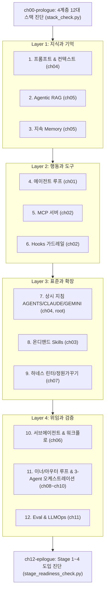

# 혼자서 프로젝트 5개 돌리는 개발자의 비밀: 루프 엔지니어링

> **프롬프트 노가다는 끝났다 — 1인 멀티 프로젝트를 자동화하는 AI 설계·관측·개선 루프의 모든 것**
>
> 🔗 **웹 PPT 바로가기**: [https://yojulab.github.io/learn_Loop_engineering/](https://yojulab.github.io/learn_Loop_engineering/)  
> ([프롤로그 PPT](https://yojulab.github.io/learn_Loop_engineering/prologue.html) · [메인 5시간 강의 PPT](https://yojulab.github.io/learn_Loop_engineering/lecture.html) · [카툰 심화 워크숍 PPT](https://yojulab.github.io/learn_Loop_engineering/workshop.html))

감으로 프롬프트만 고치다 실패하는 패턴을 깨고, **배포(Launch) · 관측(Observe) · 평가(Evaluate) · 개선(Improve)** 의 데이터 기반 루프로 전환하여 1인이 멀티 프로젝트를 자동화하는 실전 아키텍처와 전 단원(`ch00`~`ch12`) 실습 코드를 제공합니다.

## 1. 단원 학습 목표 & 12대 스택 4계층 맵

- **학습 목표 1**: 감에 의존하는 프롬프팅을 넘어 **배포(Launch)·관측(Observe)·평가(Evaluate)·개선(Improve)** 루프와 이를 뒷받침하는 **4계층 12대 요소**의 책임을 이해한다.
- **학습 목표 2**: 프롬프트·컨텍스트·RAG·메모리(1계층), 에이전트 루프·MCP·훅(2계층), 지침 파일·스킬·하네스(3계층), 서브에이전트·오케스트레이션·Eval/LLMOps(4계층)를 실행 가능한 코드로 검증한다.
- **학습 목표 3**: 외부 API 키나 네트워크 없이도 컨테이너 내부에서 결정론적 오프라인 테스트와 CLI 실습을 재현한다.
- **학습 목표 4**: 도서 본문 내 `💻 Git 예제` 경로(`ch01/`~`ch11/`)와 정식 단원 디렉터리(`ch00-prologue/`~`ch12-epilogue/`)를 동일한 인터페이스로 탐색한다.

| 계층 (Layer) | 핵심 역할 | 12대 스택 요소 | 매핑 단원 |
| :--- | :--- | :--- | :--- |
| **Layer 1. 지식과 기억** | 모델이 무엇을 알고 판단하는가 | ① 프롬프트 & 컨텍스트, ② Agentic RAG, ③ 지속 Memory | `ch04`, `ch05` |
| **Layer 2. 행동과 도구** | 모델이 외부 세계와 어떻게 상호작용하는가 | ④ 에이전트 루프, ⑤ MCP, ⑥ 훅(Hooks) | `ch01`, `ch02` |
| **Layer 3. 표준과 확장** | 팀 규칙과 전문 노하우를 어떻게 재사용하는가 | ⑦ 상시 지침(`AGENTS.md`/`CLAUDE.md`/`GEMINI.md`), ⑧ 스킬(Skills), ⑨ 하네스 엔지니어링 | `ch03`, `ch04`, `ch07` |
| **Layer 4. 위임과 검증** | 복수 에이전트가 어떻게 장기 작업을 완주하고 검증받는가 | ⑩ 서브에이전트, ⑪ 이너·아우터 루프 & 오케스트레이션, ⑫ Eval & LLMOps | `ch06`, `ch08`, `ch09`, `ch10`, `ch11` |

## 2. 아키텍처 다이어그램 (Mermaid)



## 3. 디렉터리 및 소스 파일 구조

| 단원 / 경로 | 도서 호환 경로 (`💻 Git 예제`) | 핵심 내용 | 상태 |
| :--- | :--- | :--- | :--- |
| `README.md`, `AGENTS.md`, `CLAUDE.md`, `CHATGPT.md`, `GEMINI.md`, `platforms/`, `docs/ARCHITECTURE.md` | 루트 | 범용 규칙서, 에이전트별 포인터, 4계층 설계서 | Phase 1 |
| `scripts/verify_chapters.py`, `tests/test_repo_root.py` | 루트 | 전 단원 통합 검증 러너 및 루트 무결성 테스트 | Phase 1 |
| `ch00-prologue/` | `ch00-prologue/` | `stack_check.py` (4계층 12대 스택 진단), `agent_check.py` (로컬 AI & 플랫폼 확인) | Phase 1 |
| `ch01-agentic-coding/quote-cli/` | `ch01/quote-cli/` | `quote_cli.py`, `interactive_demo.py`, `quotes.json` | Phase 2 |
| `ch02-mcp-and-hooks/quote-mcp/` | `ch02/quote-mcp/`, `ch04/quote-cli/` *(제2장 오타 호환)* | MCP 명언 서버 + PreToolUse/PostToolUse 훅 | Phase 2 |
| `ch03-skills/github-workflow-skills/` | `ch03/github-workflow-skills/` | 3단계 확장형 GitHub 워크플로 스킬 5종 | Phase 2 |
| `ch04-context-engineering/` | `ch04/` (`prompt_template.txt` 등) | 7항목 프롬프트, Few-shot, 4대 층위 지침, `context_budget.py` | Phase 3 |
| `ch05-rag-and-memory/memory_pattern/` | `ch05/memory_pattern/` | `memory_manager.py`, `agentic_rag.py`, `TASKS.md`/`JOURNAL.md` | Phase 3 |
| `ch06-subagents-workflow/` | `ch06/quote-cli/` | `.claude/agents/` 5종, 검색 확장 CLI, `dynamic_workflow.py` | Phase 4 |
| `ch07-harness-engineering/harness-templates/` | `ch07/harness-templates/` | 100줄 `AGENTS.md`, `arch_linter.py`, `guardrails.py`, `doc_gardening.py` | Phase 4 |
| `ch08-inner-ralph-loop/rss-wiki/` | `ch08/rss-wiki/` | FTS5 `db.py`, `collector.py`, `app.py`, `ralph_loop.sh`, `goal_evaluator.py` | Phase 4 |
| `ch09-orchestration/harness/` | `ch09/harness/` | 3-Agent 오케스트레이션, 블라인드 합의, 0~3점 채점표 | Phase 5 |
| `ch10-outer-loop/todo-loop/` | `ch10/todo-loop/` | 5단계 아우터 루프, 7대 완료·중단 조건, `CALC-001`~`004` | Phase 5 |
| `ch11-eval-and-llmops/support-assistant/` | `ch11/support-assistant/` | `seed_prompts.py`, `prompting.py`, 3종 Eval, JSONL 폴백, 회귀 비교기 | Phase 5 |
| `ch12-epilogue/` | `ch12-epilogue/` | 4계층 치트시트, `stage_readiness_check.py` | Phase 5 |

## 4. 컨테이너 실행 & 테스트 명령어

컨테이너 작업 디렉터리: `graphrag_agent_app_fullstack:/apps/learn_Loop_engineering`

```bash
# 프롤로그 4계층 12대 스택 진단
python3 ch00-prologue/stack_check.py
python3 ch00-prologue/stack_check.py --json

# 로컬 AI 동작 및 Agent Platform 확인 (간략 문장 응답)
python3 ch00-prologue/agent_check.py
python3 ch00-prologue/agent_check.py --platform gemini --prompt "에이전트 런타임 확인"
AGENT_PLATFORM=gemini python3 ch00-prologue/agent_check.py --json

# Phase 1 통합 검증 (루트 문서, 가드레일, ch00-prologue)
python3 scripts/verify_chapters.py --phase 1
python3 scripts/verify_chapters.py --phase 1 --json

# 단위 테스트 직접 실행
python3 -m unittest discover -s tests -p "test_*.py"
python3 -m unittest discover -s ch00-prologue/tests -p "test_*.py"

# 전 단원 통합 검증 (전체 Phase 구현 완료 시)
python3 scripts/verify_chapters.py --all
```

### Docker Compose 실습 환경 (`dockers/`)

- **구성**: Langfuse(`http://localhost:30000`) + PostgreSQL + 앱 컨테이너(Python 3.13 · Claude Code CLI · Antigravity CLI `agy` · langfuse SDK)
- **설정**: 볼륨 경로·계정·API 키는 `dockers/.env`에서 설정 (`cp dockers/.env.example dockers/.env`)
- **실행**: `cd dockers && docker compose up -d --build && docker compose exec app bash` (자세한 내용: [`dockers/README.md`](dockers/README.md))

#### Langfuse 대시보드 초기 데이터 적재 (`seed_langfuse_dashboard.py --json`)

- **실행 이유**: Langfuse 최초 기동 직후에는 Dashboard가 비어(`No data`) 있으므로, 외부 LLM API 키 없이도 AI 폴백 모드로 `Traces`, `Model costs/Usage`, `User consumption`, `Scores`, `Latencies`, `Sessions`, `Prompts`, `Datasets` 전체 항목을 즉시 시각화·점검하기 위해 실행합니다.

```bash
# 기본값으로 적재 (옵션 생략 시 24시간 간격 × 시간당 3회 = 72건, 3대 모델, '고객지원 및 장애 트리아지')
python3 ch11/support-assistant/seed_langfuse_dashboard.py --json

# 시간 간격(--hours), 시간당 회수(--per-hour), 모델(--models), 업무 주제(--topic) 지정 예시
python3 ch11/support-assistant/seed_langfuse_dashboard.py \
  --hours 12 --per-hour 4 --models "gpt-4o-mini,gemini-2.5-flash" --topic "결제 및 장애 트리아지" --json
```

### Any-Platform 실행 지원 (Claude · ChatGPT · Gemini)

| 플랫폼 | 진입 지침 파일 | 어댑터 & 단원별 호환 파일 (`*_[플랫폼].*`) | 비대화형 실행 예시 |
| :--- | :--- | :--- | :--- |
| **Claude** | `CLAUDE.md` | `platforms/adapter_claude.py`, `*_claude.*` | `AGENT_PLATFORM=claude python3 ch10/todo-loop/loop.py --platform claude` |
| **ChatGPT / Codex** | `AGENTS.md`, `CHATGPT.md` | `platforms/adapter_chatgpt.py`, `*_chatgpt.*` | `AGENT_PLATFORM=chatgpt python3 ch10/todo-loop/loop.py --platform chatgpt` |
| **Gemini / Antigravity** | `GEMINI.md` | `platforms/adapter_gemini.py`, `*_gemini.*` | `AGENT_PLATFORM=gemini python3 ch10/todo-loop/loop.py --platform gemini` |

### Web PPT (GitHub Pages: `docs/`)

- **배포 URL**: [https://yojulab.github.io/learn_Loop_engineering/](https://yojulab.github.io/learn_Loop_engineering/)
- **분기 덱**: [`docs/index.html`](docs/index.html) (Home) · [`docs/prologue.html`](docs/prologue.html) (프롤로그 4장) · [`docs/lecture.html`](docs/lecture.html) (5시간 메인 39장) · [`docs/workshop.html`](docs/workshop.html) (카툰 워크숍 39장) · [`docs/presenter.html`](docs/presenter.html) (발표자 창)
- **최종 목적 아키텍처**: `LangGraph`(상태 기반 에이전트 오케스트레이션) + `LiteLLM Proxy` + `Langfuse`(Trace 모니터링 · Eval · Save as Prompt 버전 개선 루프)
- **구성**: `ch00`~`ch12` 전 단원 이론 슬라이드 + **단원별 실습 미션과 클릭 토글(`<details>`) 모범 답안 & 해결 프롬프트 한 페이지 배치**
- **로컬 미리보기**: `python3 -m http.server 8080 --directory docs` 후 브라우저에서 `http://localhost:8080` 접속 (단축키 `A`: 모범답안·프롬프트 토글, `O`: 목차, `P`: 발표자 창, `F`: 전체 화면)

## 5. 핵심 체크리스트

- [ ] `AGENTS.md`는 제7장 원칙에 따라 100줄 이하 목차형 규칙서로 유지되는가?
- [ ] 모든 단원(`ch00-prologue/` ~ `ch12-epilogue/`)이 표준 5단 `README.md` 템플릿을 준수하는가?
- [ ] 외부 네트워크/API 키 없이 `unittest` 및 `scripts/verify_chapters.py`가 결정론적으로 통과하는가?
- [ ] 도서 본문 내 `💻 Git 예제` 호환 경로(`ch01/`~`ch11/`, `ch04/quote-cli/`)가 깨짐 없이 연결되는가?
