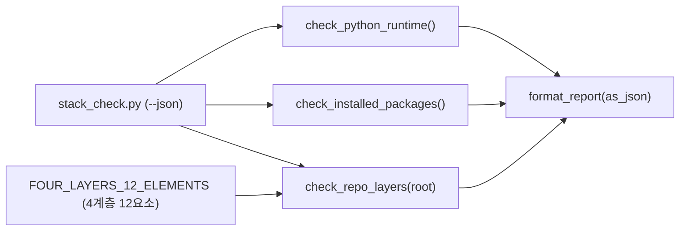

# 프롤로그 (`ch00-prologue`) — 모던 AI 에이전트 스택 한눈에 보기

## 1. 단원 학습 목표 & 12대 스택 4계층 위치

- **학습 목표 1**: LLM 에이전트 시스템을 구성하는 **4계층 12대 요소**의 전체 지형도를 파악한다.
- **학습 목표 2**: 현재 컨테이너(`Python 3.13`, `sqlite3 FTS5`, 기설치/폴백 패키지)의 런타임 준비 상태를 CLI로 즉시 진단한다.
- **학습 목표 3**: 해당 챕터 폴더(`ch00-prologue/`)로 이동한 뒤 AI CLI(`claude`, `agy`, `codex`)에 사용자 프롬프트를 입력해 스택과 플랫폼 어댑터를 검증한다.

| 계층 | 위치 | 본 단원 역할 |
| :--- | :--- | :--- |
| **전 계층 조망 (Layer 1 ~ Layer 4)** | `ch00-prologue/` | 12대 스택 요소 메타데이터 카탈로그 및 환경·플랫폼 어댑터 상태 진단 |

## 2. 아키텍처 다이어그램 (Mermaid)



## 3. 디렉터리 및 소스 파일 구조

```text
ch00-prologue/
├── README.md                 # 프롤로그 안내서 (표준 5단 구성 + 프롬프트 예시 3선)
├── AGENTS.md                 # Codex / 공용 에이전트 지침 (100줄 이하)
├── CLAUDE.md                 # Claude Code 1층위 상시 지침
├── GEMINI.md                 # Gemini / Antigravity (agy) 상시 지침
├── .claude/rules/prologue.md # Claude 경로별 조건부 규칙
├── .gemini/                  # Gemini CLI 설정 (settings.json, rules.md)
├── stack_check.py            # 4계층 12대 스택 런타임·패키지·저장소 점검 CLI
├── agent_check.py            # 로컬 AI 동작 및 Agent Platform 확인 CLI
└── tests/
    ├── test_stack_check.py   # stack_check.py 단위 테스트
    └── test_agent_check.py   # agent_check.py 단위 테스트
```

## 4. 실습 방식 & 사용자 입력 프롬프트 예시 (AI CLI)

### 4.1 실습 절차 (챕터 루트 이동 후 AI CLI 접속)

```bash
cd ch00-prologue
# 사용하는 AI CLI로 접속 (AGENTS.md / CLAUDE.md / GEMINI.md 자동 로드)
claude   # 또는 agy / codex
```

### 4.2 사용자 입력 프롬프트 예시 (3개 이상)

- **프롬프트 예시 1 (4계층 12대 스택 환경 진단)**:
  > "현재 `ch00-prologue` 폴더에서 `stack_check.py --json`을 실행해 Python 버전, SQLite FTS5 지원 여부, 4계층 12대 스택 준비 상태를 JSON으로 요약해줘."

- **프롬프트 예시 2 (Any-Platform 어댑터 및 오프라인 폴백 점검)**:
  > "`agent_check.py`를 사용해 `claude`, `chatgpt`, `gemini`, `offline` 플랫폼 모드를 각각 점검하고 `AGENT_PLATFORM=offline python3 agent_check.py --json` 출력 결과를 보여줘."

- **프롬프트 예시 3 (프롤로그 단위 테스트 전체 검증)**:
  > "현재 폴더의 `tests/` 단위 테스트(`test_stack_check.py`, `test_agent_check.py`)를 모두 실행하고 실패 항목이 없는지 검증 리포트를 출력해줘."

### 4.3 참고용 직접 실행 명령어

```bash
python3 stack_check.py --json
AGENT_PLATFORM=offline python3 agent_check.py --json
python3 -m unittest discover -s tests -p "test_*.py" -v
```

## 5. 핵심 체크리스트

- [ ] `ch00-prologue/` 루트에 `AGENTS.md`, `CLAUDE.md`, `GEMINI.md`, `.claude/`, `.gemini/`가 모두 구성되어 있는가?
- [ ] `FOUR_LAYERS_12_ELEMENTS`에 4개 계층과 12개 요소가 빠짐없이 정의되어 있는가?
- [ ] AI CLI에 사용자 프롬프트를 입력해 `stack_check.py --json` 및 단위 테스트 통과 결과를 확인할 수 있는가?
