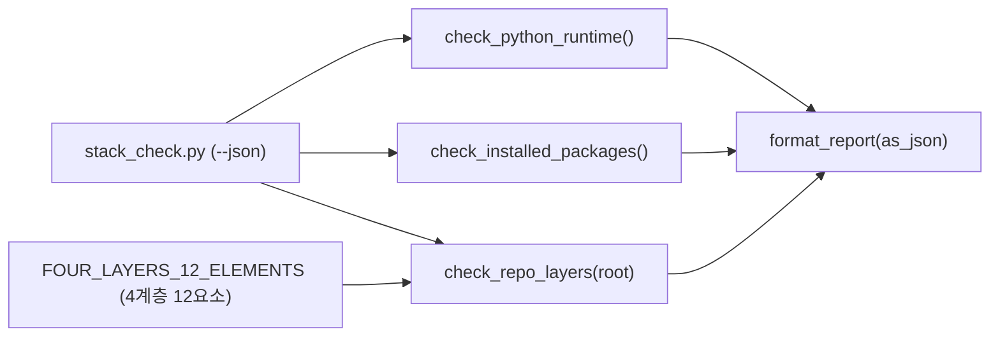

# 프롤로그 (`ch00-prologue`) — 2026 모던 AI 에이전트 스택 한눈에 보기

## 1. 단원 학습 목표 & 12대 스택 4계층 위치

- **학습 목표 1**: LLM 에이전트 시스템을 구성하는 **4계층 12대 요소**의 전체 지형도를 파악한다.
- **학습 목표 2**: 현재 컨테이너(`Python 3.13`, `sqlite3 FTS5`, 기설치/폴백 패키지)의 런타임 준비 상태를 CLI로 즉시 진단한다.
- **학습 목표 3**: 저장소 루트와 단원 디렉터리가 4계층 아키텍처와 어떻게 매핑되는지 확인한다.

| 계층 | 위치 | 본 단원 역할 |
| :--- | :--- | :--- |
| **전 계층 조망 (Layer 1 ~ Layer 4)** | `ch00-prologue` | 12대 스택 요소 메타데이터 카탈로그 및 환경·저장소 상태 진단 |

## 2. 아키텍처 다이어그램 (Mermaid)



## 3. 디렉터리 및 소스 파일 구조

```text
ch00-prologue/
├── README.md                 # 프롤로그 안내서 (표준 5단 구성)
├── stack_check.py            # 4계층 12대 스택 런타임·패키지·저장소 점검 CLI
├── agent_check.py            # 로컬 AI 동작 및 Agent Platform 확인 CLI
└── tests/
    ├── test_stack_check.py   # stack_check.py 단위 테스트 (unittest.TestCase)
    └── test_agent_check.py   # agent_check.py 단위 테스트 (unittest.TestCase)
```

## 4. 컨테이너 실행 & 테스트 명령어

```bash
# 텍스트 리포트 출력 (exit 0)
python3 ch00-prologue/stack_check.py

# JSON 리포트 출력 (exit 0)
python3 ch00-prologue/stack_check.py --json

# 로컬 AI 동작 및 Agent Platform 확인 (기본/플랫폼 지정/간략 문장 응답)
python3 ch00-prologue/agent_check.py
python3 ch00-prologue/agent_check.py --platform gemini --prompt "로컬 AI 동작 확인"
AGENT_PLATFORM=gemini python3 ch00-prologue/agent_check.py --json

# 단위 테스트 및 Phase 1 검증
python3 -m unittest discover -s ch00-prologue/tests -p "test_*.py"
python3 scripts/verify_chapters.py --chapter ch00
```

## 5. 핵심 체크리스트

- [ ] `FOUR_LAYERS_12_ELEMENTS`에 4개 계층과 12개 요소가 빠짐없이 정의되어 있는가?
- [ ] `python3 ch00-prologue/stack_check.py --json` 실행 시 유효한 JSON과 종료 코드 `0`을 반환하는가?
- [ ] Python 3.13 런타임 및 SQLite FTS5 지원 여부가 정상 감지되는가?
