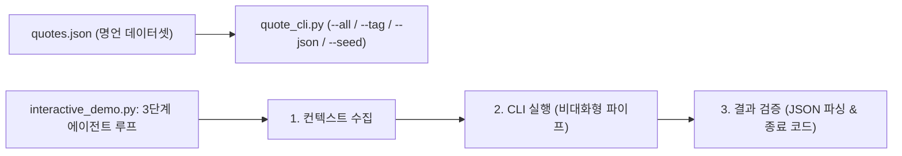

# 제1장 (`ch01-agentic-coding`) — 바이브 코딩과 에이전틱 코딩의 탄생

## 1. 단원 학습 목표 & 12대 스택 4계층 위치

- **학습 목표 1**: 단순 프롬프트 기반 '바이브 코딩'과 **컨텍스트 수집 → 작업 수행 → 결과 검증** 루프를 도는 에이전틱 코딩의 차이를 이해한다.
- **학습 목표 2**: UNIX 파이프와 CLI 플래그(`--all`, `--tag`, `--json`, `--seed`)를 활용해 에이전트가 비대화형(Non-interactive)으로 도구를 호출하는 구조를 구현한다.
- **학습 목표 3**: 결정론적 단위 테스트(`unittest`)로 CLI 동작을 자동 검증한다.

| 계층 | 스택 요소 | 본 단원 구현 |
| :--- | :--- | :--- |
| **Layer 2: 행동과 도구** | ④ 에이전트 코딩 루프 & CLI | `quote_cli.py`, `interactive_demo.py`, `quotes.json` |

## 2. 아키텍처 다이어그램 (Mermaid)



## 3. 디렉터리 및 소스 파일 구조

- 정식 구현 경로: `ch01-agentic-coding/quote-cli/`
- 도서 `💻 Git 예제` 호환 경로: `ch01/quote-cli/` (`../ch01-agentic-coding/quote-cli` 심볼릭 링크)

```text
ch01-agentic-coding/
├── README.md
└── quote-cli/
    ├── quotes.json
    ├── quote_cli.py
    ├── interactive_demo.py
    └── tests/
        └── test_quote_cli.py
```

## 4. 컨테이너 실행 & 테스트 명령어

```bash
# 전체 명언 출력 및 태그 필터링
python3 ch01-agentic-coding/quote-cli/quote_cli.py --all
python3 ch01-agentic-coding/quote-cli/quote_cli.py --tag engineering --json
python3 ch01/quote-cli/quote_cli.py --seed 42

# 대화형/비대화형 파이프 에이전트 루프 데모
python3 ch01-agentic-coding/quote-cli/interactive_demo.py --task "engineering 태그 명언 조회"

# 단위 테스트 및 Phase 2 검증
python3 -m unittest discover -s ch01-agentic-coding/quote-cli/tests -p "test_*.py"
python3 scripts/verify_chapters.py --chapter ch01
```

## 5. 핵심 체크리스트

- [ ] `quote_cli.py`가 `--all`, `--tag`, `--json`, `--seed` 옵션을 정상 처리하는가?
- [ ] `interactive_demo.py`가 비대화형 파이프 입력과 3단계 루프를 결정론적으로 실행하는가?
- [ ] `ch01/quote-cli` 호환 심볼릭 링크가 깨짐 없이 연결되어 있는가?
