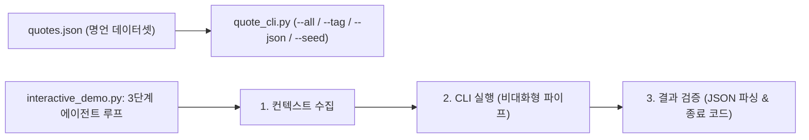

# 제1장 (`ch01-agentic-coding`) — 바이브 코딩과 에이전틱 코딩의 탄생

## 1. 단원 학습 목표 & 12대 스택 4계층 위치

- **학습 목표 1**: 단순 프롬프트 기반 '바이브 코딩'과 **컨텍스트 수집 → 작업 수행 → 결과 검증** 루프를 도는 에이전틱 코딩의 차이를 이해한다.
- **학습 목표 2**: UNIX 파이프와 CLI 플래그(`--all`, `--tag`, `--json`, `--seed`)를 활용해 에이전트가 비대화형(Non-interactive)으로 도구를 호출하는 구조를 구현한다.
- **학습 목표 3**: `ch01-agentic-coding/` 폴더로 이동해 AI CLI(`claude`, `agy`, `codex`)에 사용자 프롬프트를 입력하여 구현·실행·단위 테스트 검증 루프를 완주한다.

| 계층 | 스택 요소 | 본 단원 구현 |
| :--- | :--- | :--- |
| **Layer 2: 행동과 도구** | ④ 에이전트 코딩 루프 & CLI | `quote_cli.py`, `interactive_demo.py`, `quotes.json` |

## 2. 아키텍처 다이어그램 (Mermaid)



## 3. 디렉터리 및 소스 파일 구조

- 정식 구현 경로 (챕터 루트): `ch01-agentic-coding/`
- 도서 `💻 Git 예제` 호환 경로: `ch01/quote-cli/` (`../ch01-agentic-coding` 심볼릭 링크)

```text
ch01-agentic-coding/
├── README.md
├── AGENTS.md
├── CLAUDE.md
├── GEMINI.md
├── .claude/rules/agent-loop.md
├── .gemini/
├── quotes.json
├── quote_cli.py
├── interactive_demo.py
└── tests/
    └── test_quote_cli.py
```

## 4. 실습 방식 & 사용자 입력 프롬프트 예시 (AI CLI)

### 4.1 실습 절차 (챕터 루트 이동 후 AI CLI 접속)

```bash
cd ch01-agentic-coding
claude   # 또는 agy / codex
```

### 4.2 사용자 입력 프롬프트 예시 (3개 이상)

- **프롬프트 예시 1 (태그 필터링 및 JSON 파이프 출력)**:
  > "현재 `ch01-agentic-coding` 폴더에서 `quote_cli.py --tag engineering --json`을 실행해 `engineering` 태그 명언 목록을 JSON으로 출력하고 스키마(`id`, `text`, `author`, `tags`)를 검증해줘."

- **프롬프트 예시 2 (결정론적 시드 랜덤 명언 & 3단계 루프 데모)**:
  > "`quote_cli.py --seed 42 --json`의 결정론적 출력이 동일한지 확인하고, `interactive_demo.py --task 'engineering 태그 명언 조회'`를 실행해 3단계 에이전트 루프(수집-실행-검증) 결과를 요약해줘."

- **프롬프트 예시 3 (신규 기능 검증 및 단위 테스트 실행)**:
  > "`tests/test_quote_cli.py` 단위 테스트를 전체 실행해 통과 건수를 보고하고, 만약 실패하는 케이스가 있다면 원인을 분석해 수정 후 재검증해줘."

### 4.3 참고용 직접 실행 명령어

```bash
python3 quote_cli.py --tag engineering --json
python3 quote_cli.py --seed 42 --json
python3 interactive_demo.py --task "engineering 태그 명언 조회"
python3 -m unittest discover -s tests -p "test_*.py" -v
```

## 5. 핵심 체크리스트

- [ ] `ch01-agentic-coding/` 루트에 `AGENTS.md`, `CLAUDE.md`, `GEMINI.md`, `.claude/`, `.gemini/`가 존재하는가?
- [ ] `quote_cli.py`가 `--all`, `--tag`, `--json`, `--seed` 옵션을 정상 처리하는가?
- [ ] `ch01/quote-cli` 호환 심볼릭 링크가 `ch01-agentic-coding/`으로 깨짐 없이 연결되어 있는가?
