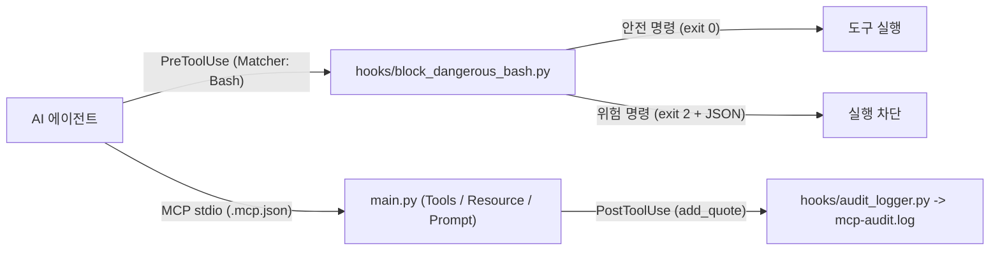

# 제2장 (`ch02-mcp-and-hooks`) — 도구를 쥐여주는 표준: MCP와 훅(Hooks)

## 1. 단원 학습 목표 & 12대 스택 4계층 위치

- **학습 목표 1**: Model Context Protocol(MCP)의 3대 기본 요소(**Tools, Resources, Prompts**)를 하나의 서버(`main.py`)로 구현한다.
- **학습 목표 2**: `.mcp.json`의 `${VAR:-default}` 환경 변수 확장 문법과 stdio 연결 구조를 이해한다.
- **학습 목표 3**: `ch02-mcp-and-hooks/` 챕터 루트에서 AI CLI로 접속해 `.claude/settings.json` 3단 훅(`PreToolUse` 위험 명령 차단 `exit 2` 및 `PostToolUse` 감사 로깅)을 실습한다.

| 계층 | 스택 요소 | 본 단원 구현 |
| :--- | :--- | :--- |
| **Layer 2: 행동과 도구** | ⑤ MCP & ⑥ 훅(Hooks) | `main.py`, `.mcp.json`, `.claude/settings.json`, `hooks/` |

## 2. 아키텍처 다이어그램 (Mermaid)



## 3. 디렉터리 및 소스 파일 구조

- 정식 구현 경로 (챕터 루트): `ch02-mcp-and-hooks/`
- 도서 `💻 Git 예제` 호환 경로:
  - `ch02/quote-mcp/` (`../ch02-mcp-and-hooks` 심볼릭 링크)
  - `ch04/quote-cli/` *(제2장 2.5절 본문 표기 오타 호환 브릿지 디렉터리)*

```text
ch02-mcp-and-hooks/
├── README.md
├── AGENTS.md
├── CLAUDE.md
├── GEMINI.md
├── .mcp.json
├── mcp_config_claude.json · mcp_config_chatgpt.json · mcp_config_gemini.json
├── .claude/
│   ├── settings.json
│   └── rules/mcp-hooks.md
├── .gemini/
├── main.py
├── quotes.json
├── hooks/
│   ├── block_dangerous_bash.py
│   ├── audit_logger.py
│   └── platform_hook_bridge.py
└── tests/
    └── test_quote_mcp_and_hooks.py
```

## 4. 실습 방식 & 사용자 입력 프롬프트 예시 (AI CLI)

### 4.1 실습 절차 (챕터 루트 이동 후 AI CLI 접속)

```bash
cd ch02-mcp-and-hooks
claude   # 또는 agy / codex
```

### 4.2 사용자 입력 프롬프트 예시 (3개 이상)

- **프롬프트 예시 1 (MCP 서버 메타데이터 및 도구/리소스/프롬프트 점검)**:
  > "현재 `ch02-mcp-and-hooks` 폴더에서 `python3 main.py`를 실행해 MCP 서버(`quote-mcp`)에 등록된 Tools(`add_quote`, `get_random_quote`), Resources(`quote://all`), Prompts(`quote_post`) 목록을 JSON으로 출력해줘."

- **프롬프트 예시 2 (PreToolUse 위험 명령 차단 훅 시뮬레이션)**:
  > "`hooks/block_dangerous_bash.py`에 위험 명령(`{"tool_name":"Bash","tool_input":{"command":"rm -rf /"}}`)과 안전 명령(`git status`)을 각각 표준 입력으로 전달해 종료 코드(`exit 2` vs `exit 0`)와 차단 JSON 응답을 비교해줘."

- **프롬프트 예시 3 (PostToolUse 감사 로거 & 멀티 플랫폼 브리지 테스트)**:
  > "`hooks/platform_hook_bridge.py`와 `tests/test_quote_mcp_and_hooks.py`를 실행해 Claude·ChatGPT·Gemini 3대 플랫폼의 훅 페이로드 차단/허용 및 감사 로그(`audit_logger.py`) 동작을 검증해줘."

### 4.3 참고용 직접 실행 명령어

```bash
python3 main.py
echo '{"tool_name":"Bash","tool_input":{"command":"rm -rf /"}}' | python3 hooks/block_dangerous_bash.py
python3 -m unittest discover -s tests -p "test_*.py" -v
```

## 5. 핵심 체크리스트

- [ ] `ch02-mcp-and-hooks/` 루트에 `AGENTS.md`, `CLAUDE.md`, `GEMINI.md`, `.mcp.json`, `.claude/settings.json`, `.gemini/`가 모두 배치되어 있는가?
- [ ] `block_dangerous_bash.py`가 위험 명령 입력 시 종료 코드 `2`와 차단 사유 JSON을 출력하는가?
- [ ] `ch02/quote-mcp` 및 `ch04/quote-cli/` 호환 링크가 모두 유효한가?
