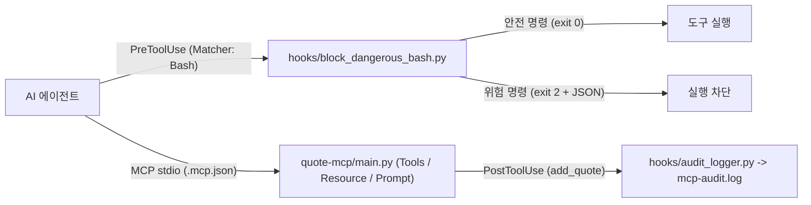

# 제2장 (`ch02-mcp-and-hooks`) — 도구를 쥐여주는 표준: MCP와 훅(Hooks)

## 1. 단원 학습 목표 & 12대 스택 4계층 위치

- **학습 목표 1**: Model Context Protocol(MCP)의 3대 기본 요소(**Tools, Resources, Prompts**)를 하나의 서버(`quote-mcp`)로 구현한다.
- **학습 목표 2**: `.mcp.json`의 `${VAR:-default}` 환경 변수 확장 문법과 stdio 연결 구조를 이해한다.
- **학습 목표 3**: `.claude/settings.json` 3단 훅(`이벤트 -> 매처 -> 핸들러`)으로 `PreToolUse` 위험 명령 차단(`exit 2`)과 `PostToolUse` 감사 로깅을 강제한다.

| 계층 | 스택 요소 | 본 단원 구현 |
| :--- | :--- | :--- |
| **Layer 2: 행동과 도구** | ⑤ MCP & ⑥ 훅(Hooks) | `quote-mcp/main.py`, `.mcp.json`, `.claude/settings.json`, `hooks/` |

## 2. 아키텍처 다이어그램 (Mermaid)



## 3. 디렉터리 및 소스 파일 구조

- 정식 구현 경로: `ch02-mcp-and-hooks/quote-mcp/`
- 도서 `💻 Git 예제` 호환 경로:
  - `ch02/quote-mcp/` (`../ch02-mcp-and-hooks/quote-mcp` 심볼릭 링크)
  - `ch04/quote-cli/` *(제2장 2.5절 본문 표기 오타 호환 브릿지 디렉터리 — `main.py`, `quotes.json`, `.mcp.json`, `.claude`, `cli` 심볼릭 링크 제공)*

```text
ch02-mcp-and-hooks/
├── README.md
└── quote-mcp/
    ├── main.py
    ├── quotes.json
    ├── .mcp.json
    ├── .claude/settings.json
    ├── hooks/
    │   ├── block_dangerous_bash.py
    │   └── audit_logger.py
    └── tests/
        └── test_quote_mcp_and_hooks.py
```

## 4. 컨테이너 실행 & 테스트 명령어

```bash
# 훅 단독 테스트 (위험 명령 차단 시 exit 2)
echo '{"tool_name":"Bash","tool_input":{"command":"git status"}}' | python3 ch02-mcp-and-hooks/quote-mcp/hooks/block_dangerous_bash.py
echo '{"tool_name":"Bash","tool_input":{"command":"rm -rf /tmp/test"}}' | python3 ch02-mcp-and-hooks/quote-mcp/hooks/block_dangerous_bash.py

# 단위 테스트 및 Phase 2 검증
python3 -m unittest discover -s ch02-mcp-and-hooks/quote-mcp/tests -p "test_*.py"
python3 scripts/verify_chapters.py --chapter ch02
```

## 5. 핵심 체크리스트

- [ ] `main.py`가 `FastMCP` 미설치 환경에서도 `LocalFastMCP` 어댑터로 Tools(`get_random_quote`, `add_quote`), Resource(`quote://all`), Prompt(`quote_post`)를 제공하는가?
- [ ] `block_dangerous_bash.py`가 `rm -rf`, `git push --force/-f`, `git reset --hard`, `DROP TABLE`, `find . -delete`, `mkfs` 차단 시 JSON 출력 및 `exit 2`를 반환하는가?
- [ ] `ch02/quote-mcp` 및 제2장 오타 호환 경로 `ch04/quote-cli/` 링크가 모두 유효한가?
