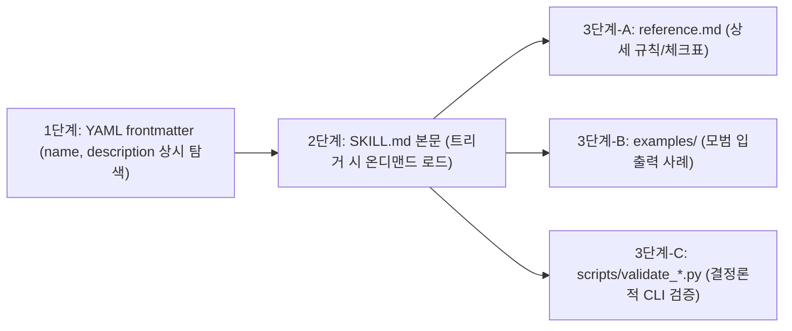

# 제3장 (`ch03-skills`) — 온디맨드 노하우 모듈: 스킬(Skills)

## 1. 단원 학습 목표 & 12대 스택 4계층 위치

- **학습 목표 1**: 상시 로드되는 `CLAUDE.md`/`AGENTS.md`와 필요할 때만 로드되는 **온디맨드 스킬(Skills)**의 토큰 효율 차이를 이해한다.
- **학습 목표 2**: **1단계(`SKILL.md` YAML frontmatter) → 2단계(`SKILL.md` 본문 절차) → 3단계(`reference.md`, `examples/`, `scripts/validate_*.py`)** 점진적 공개(Progressive Disclosure) 구조를 구현한다.
- **학습 목표 3**: `ch03-skills/` 폴더로 이동해 AI CLI에서 사용자 프롬프트로 5종 GitHub 워크플로 스킬을 트리거하고 검증 스크립트로 판정한다.

| 계층 | 스택 요소 | 본 단원 구현 |
| :--- | :--- | :--- |
| **Layer 3: 표준과 확장** | ⑧ 온디맨드 스킬(Skills) | 5종 스킬(`gh-issue`, `git-commit`, `gh-pr`, `gh-review`, `gh-address-review`) 및 검증 스크립트 |

## 2. 아키텍처 다이어그램 (Mermaid)



## 3. 디렉터리 및 소스 파일 구조

- 정식 구현 경로 (챕터 루트): `ch03-skills/`

```text
ch03-skills/
├── README.md
├── AGENTS.md
├── CLAUDE.md
├── GEMINI.md
├── .claude/rules/skills.md
├── .gemini/
├── skills_claude.md · skills_chatgpt.md · skills_gemini.md
├── gh-issue/          # SKILL.md, reference.md, examples/, scripts/validate_issue.py
├── git-commit/        # SKILL.md, reference.md, examples/, scripts/validate_commit.py
├── gh-pr/             # SKILL.md, reference.md, examples/, scripts/validate_pr.py
├── gh-review/         # SKILL.md, reference.md, examples/, scripts/validate_review.py
├── gh-address-review/ # SKILL.md, reference.md, examples/, scripts/validate_address_review.py
└── tests/
    └── test_github_workflow_skills.py
```

## 4. 실습 방식 & 사용자 입력 프롬프트 예시 (AI CLI)

### 4.1 실습 절차 (챕터 루트 이동 후 AI CLI 접속)

```bash
cd ch03-skills
claude   # 또는 agy / codex
```

### 4.2 사용자 입력 프롬프트 예시 (3개 이상)

- **프롬프트 예시 1 (`git-commit` 스킬 온디맨드 로드 및 커밋 메시지 검증)**:
  > "현재 `ch03-skills` 폴더의 `git-commit/SKILL.md`와 `reference.md` 규칙에 맞춰 Conventional Commit 예시 메시지를 작성하고 `git-commit/scripts/validate_commit.py`로 검증 결과를 출력해줘."

- **프롬프트 예시 2 (`gh-issue` 및 `gh-pr` 스킬 기반 이슈·PR 본문 검증)**:
  > "`gh-issue/examples/sample_issue.md`와 `gh-pr/examples/sample_pr.md`를 각각의 검증 스크립트(`validate_issue.py`, `validate_pr.py`)로 실행해 필수 섹션 통과 여부를 확인해줘."

- **프롬프트 예시 3 (5종 GitHub 워크플로 스킬 전수 테스트)**:
  > "`tests/test_github_workflow_skills.py`를 실행해 5종 스킬(`gh-issue`, `git-commit`, `gh-pr`, `gh-review`, `gh-address-review`)의 3단계 구조와 YAML frontmatter 무결성을 전체 검증해줘."

### 4.3 참고용 직접 실행 명령어

```bash
python3 git-commit/scripts/validate_commit.py git-commit/examples/sample_commit.txt
python3 gh-issue/scripts/validate_issue.py gh-issue/examples/sample_issue.md
python3 -m unittest discover -s tests -p "test_*.py" -v
```

## 5. 핵심 체크리스트

- [ ] `ch03-skills/` 루트에 `AGENTS.md`, `CLAUDE.md`, `GEMINI.md`, `.claude/`, `.gemini/` 및 5종 스킬 폴더가 존재하는가?
- [ ] 모든 `SKILL.md` 상단에 YAML frontmatter(`name`, `description`)가 선언되어 있는가?
- [ ] 각 검증 스크립트가 정상 입력에 종료 코드 `0`, 형식 위반 입력에 종료 코드 `1`을 반환하는가?
