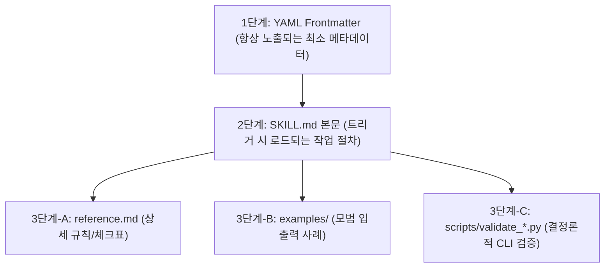

# 제3장 (`ch03-skills`) — 온디맨드 노하우 모듈: 스킬(Skills)

## 1. 단원 학습 목표 & 12대 스택 4계층 위치

- **학습 목표 1**: 컨텍스트 윈도우를 낭비하지 않고 필요할 때만 로드하는 **온디맨드 스킬(Skills)**의 3단계 점진적 공개(Progressive Disclosure) 구조를 이해한다.
- **학습 목표 2**: `SKILL.md`(메타데이터·절차) + `reference.md`(세부 기준) + `examples/`(참조 사례) + `scripts/validate_*.py`(결정론적 검증) 패턴으로 GitHub 워크플로 5종 스킬을 구현한다.
- **학습 목표 3**: 이슈·커밋·PR·리뷰·리뷰 대응의 품질 게이트를 자동화한다.

| 계층 | 스택 요소 | 본 단원 구현 |
| :--- | :--- | :--- |
| **Layer 3: 표준과 확장** | ⑧ 온디맨드 스킬(Skills) | `github-workflow-skills/` 5종 스킬 및 검증 스크립트 |

## 2. 아키텍처 다이어그램 (Mermaid)



## 3. 디렉터리 및 소스 파일 구조

- 정식 구현 경로: `ch03-skills/github-workflow-skills/`
- 도서 `💻 Git 예제` 호환 경로: `ch03/github-workflow-skills/` (`../ch03-skills/github-workflow-skills` 심볼릭 링크)

```text
ch03-skills/
├── README.md
└── github-workflow-skills/
    ├── gh-issue/          # SKILL.md, reference.md, examples/, scripts/validate_issue.py
    ├── git-commit/        # SKILL.md, reference.md, examples/, scripts/validate_commit.py
    ├── gh-pr/             # SKILL.md, reference.md, examples/, scripts/validate_pr.py
    ├── gh-review/         # SKILL.md, reference.md, examples/, scripts/validate_review.py
    ├── gh-address-review/ # SKILL.md, reference.md, examples/, scripts/validate_address_review.py
    └── tests/
        └── test_github_workflow_skills.py
```

## 4. 컨테이너 실행 & 테스트 명령어

```bash
# 개별 스킬 검증 스크립트 실행 예시
python3 ch03-skills/github-workflow-skills/gh-issue/scripts/validate_issue.py ch03-skills/github-workflow-skills/gh-issue/examples/sample_issue.md
python3 ch03-skills/github-workflow-skills/git-commit/scripts/validate_commit.py ch03-skills/github-workflow-skills/git-commit/examples/sample_commit.txt

# 단위 테스트 및 Phase 2 검증
python3 -m unittest discover -s ch03-skills/github-workflow-skills/tests -p "test_*.py"
python3 scripts/verify_chapters.py --chapter ch03
```

## 5. 핵심 체크리스트

- [ ] 5종 스킬(`gh-issue`, `git-commit`, `gh-pr`, `gh-review`, `gh-address-review`) 모두 `SKILL.md`, `reference.md`, `examples/`, `scripts/validate_*.py`를 갖추었는가?
- [ ] 모든 `SKILL.md` 상단에 YAML frontmatter(`name`, `description`)가 존재하는가?
- [ ] 각 검증 스크립트가 정상 입력에 종료 코드 `0`, 누락·형식 위반 입력에 종료 코드 `1`을 반환하는가?
