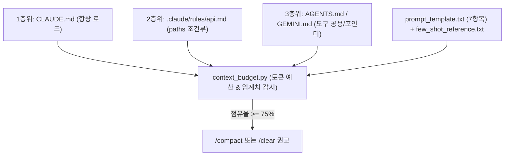

# 제4장 (`ch04-context-engineering`) — 컨텍스트 엔지니어링과 윈도우의 한계

## 1. 단원 학습 목표 & 12대 스택 4계층 위치

- **학습 목표 1**: 7가지 항목 프롬프트 템플릿과 Few-shot 참조 구현으로 모호성을 제거한다.
- **학습 목표 2**: `CLAUDE.md`(1층위) · `.claude/rules/`(2층위 `paths:` 조건부) · `AGENTS.md`(3층위) · `GEMINI.md`의 4대 층위 지침 구조를 설계한다.
- **학습 목표 3**: `ch04-context-engineering/` 폴더에서 AI CLI에 사용자 프롬프트를 입력해 `context_budget.py`로 토큰 점유율과 `/compact`·`/clear` 타이밍을 진단한다.

| 계층 | 스택 요소 | 본 단원 구현 |
| :--- | :--- | :--- |
| **Layer 1: 지식과 기억** | ① 프롬프트 & ② 컨텍스트 엔지니어링 | `prompt_template.txt`, `few_shot_reference.txt`, `context_budget.py` |
| **Layer 3: 표준과 확장** | ⑦ 4대 층위 상시 지침 | `CLAUDE.md`, `.claude/rules/api.md`, `AGENTS.md`, `GEMINI.md` |

## 2. 아키텍처 다이어그램 (Mermaid)



## 3. 디렉터리 및 소스 파일 구조

- 정식 구현 경로 (챕터 루트): `ch04-context-engineering/`
- 도서 `💻 Git 예제` 호환 경로: `ch04/prompt_template.txt`, `ch04/few_shot_reference.txt`, `ch04/claude_working_guidelines.md`

```text
ch04-context-engineering/
├── README.md
├── AGENTS.md
├── CLAUDE.md
├── GEMINI.md
├── .claude/rules/api.md
├── .gemini/
├── prompt_template.txt
├── few_shot_reference.txt
├── claude_working_guidelines.md
├── guidelines_claude.md · guidelines_chatgpt.md · guidelines_gemini.md
├── context_budget.py
└── tests/
    └── test_context_engineering.py
```

## 4. 실습 방식 & 사용자 입력 프롬프트 예시 (AI CLI)

### 4.1 실습 절차 (챕터 루트 이동 후 AI CLI 접속)

```bash
cd ch04-context-engineering
claude   # 또는 agy / codex
```

### 4.2 사용자 입력 프롬프트 예시 (3개 이상)

- **프롬프트 예시 1 (7항목 구조화 프롬프트 & 4대 지침 층위 점검)**:
  > "현재 `ch04-context-engineering` 폴더의 `prompt_template.txt`(7항목)와 `CLAUDE.md`, `.claude/rules/api.md`, `AGENTS.md`, `GEMINI.md` 4대 층위 지침 구성을 읽고 각 파일의 역할을 요약해줘."

- **프롬프트 예시 2 (컨텍스트 토큰 예산 및 임계치 초과 시뮬레이션)**:
  > "`python3 context_budget.py --json`과 `python3 context_budget.py --json --history-tokens 135000`을 각각 실행해 토큰 점유율과 Lost-in-the-Middle 경고, `/compact` 권고 기준을 비교해줘."

- **프롬프트 예시 3 (컨텍스트 엔지니어링 단위 테스트 검증)**:
  > "`tests/test_context_engineering.py` 단위 테스트를 실행해 7항목 템플릿, `paths:` 조건부 규칙, 예산 분석기가 모두 통과하는지 결과를 출력해줘."

### 4.3 참고용 직접 실행 명령어

```bash
python3 context_budget.py --json
python3 context_budget.py --json --history-tokens 135000
python3 -m unittest discover -s tests -p "test_*.py" -v
```

## 5. 핵심 체크리스트

- [ ] `prompt_template.txt`가 7가지 항목(`[목표]` ~ `[보고 형식]`)을 모두 포함하는가?
- [ ] `.claude/rules/api.md` 상단에 `paths:` YAML frontmatter가 선언되어 있는가?
- [ ] `context_budget.py`가 `warn_ratio(0.75)` 초과 시 `/compact` 권고와 Lost-in-the-Middle 경고를 출력하는가?
