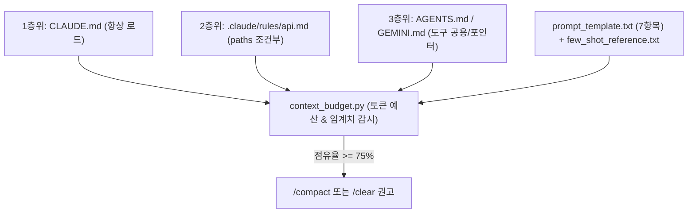

# 제4장 (`ch04-context-engineering`) — 컨텍스트 엔지니어링과 윈도우의 한계

## 1. 단원 학습 목표 & 12대 스택 4계층 위치

- **학습 목표 1**: 7가지 항목 프롬프트 템플릿과 Few-shot 참조 구현으로 모호성을 제거한다.
- **학습 목표 2**: `CLAUDE.md`(1층위) · `.claude/rules/`(2층위 `paths:` 조건부) · `AGENTS.md`(3층위) · `GEMINI.md`의 4대 층위 지침 구조를 설계한다.
- **학습 목표 3**: 컨텍스트 오염 4대 유형을 이해하고 `context_budget.py`로 토큰 점유율과 Lost-in-the-Middle 임계치를 계산해 `/compact` 및 `/clear` 타이밍을 제어한다.

| 계층 | 스택 요소 | 본 단원 구현 |
| :--- | :--- | :--- |
| **Layer 1: 지식과 기억** | ① 프롬프트 & ② 컨텍스트 엔지니어링 | `prompt_template.txt`, `few_shot_reference.txt`, `context_budget.py` |
| **Layer 3: 표준과 확장** | ⑦ 4대 층위 상시 지침 | `CLAUDE.md`, `.claude/rules/api.md`, `AGENTS.md`, `GEMINI.md` |

## 2. 아키텍처 다이어그램 (Mermaid)



## 3. 디렉터리 및 소스 파일 구조

- 정식 구현 경로: `ch04-context-engineering/`
- 도서 `💻 Git 예제` 호환 경로: `ch04/prompt_template.txt`, `ch04/few_shot_reference.txt`, `ch04/claude_working_guidelines.md`

```text
ch04-context-engineering/
├── README.md
├── prompt_template.txt
├── few_shot_reference.txt
├── claude_working_guidelines.md
├── CLAUDE.md
├── .claude/rules/api.md
├── AGENTS.md
├── GEMINI.md
├── context_budget.py
└── tests/
    └── test_context_engineering.py
```

## 4. 컨테이너 실행 & 테스트 명령어

```bash
# 컨텍스트 예산 시뮬레이터 실행
python3 ch04-context-engineering/context_budget.py
python3 ch04-context-engineering/context_budget.py --json --history-tokens 135000

# 단위 테스트 및 Phase 3 검증
python3 -m unittest discover -s ch04-context-engineering/tests -p "test_*.py"
python3 scripts/verify_chapters.py --chapter ch04
```

## 5. 핵심 체크리스트

- [ ] `prompt_template.txt`가 7가지 항목(`[목표]` ~ `[보고 형식]`)을 모두 포함하는가?
- [ ] `.claude/rules/api.md` 상단에 `paths:` YAML frontmatter가 선언되어 있는가?
- [ ] `context_budget.py`가 `warn_ratio(0.75)` 초과 시 `/compact` 권고와 Lost-in-the-Middle 경고를 출력하는가?
