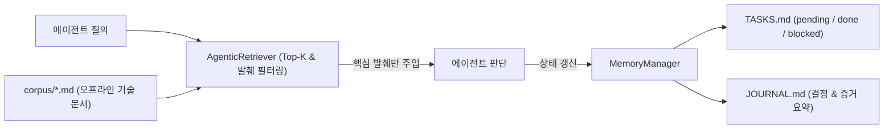

# 제5장 (`ch05-rag-and-memory`) — 외부 지식(RAG)과 세션 너머의 기억(Memory)

## 1. 단원 학습 목표 & 12대 스택 4계층 위치

- **학습 목표 1**: 전체 문서를 한 번에 넣지 않고 쿼리에 따라 필요한 발췌만 선별하는 **Agentic RAG 사서 패턴**(`Top-K`, `max_chars_per_excerpt`)을 구현한다.
- **학습 목표 2**: 대화가 끝나도 상태가 사라지지 않도록 `TASKS.md`와 `JOURNAL.md`에 작업 상태와 핵심 결정·증거를 기록하는 **지속 Memory 관리자**를 구현한다.
- **학습 목표 3**: 도구 출력 범람을 막고 다음 세션이 즉시 작업을 이어갈 수 있는 파일 매개 기억 패턴을 검증한다.

| 계층 | 스택 요소 | 본 단원 구현 |
| :--- | :--- | :--- |
| **Layer 1: 지식과 기억** | ③ Agentic RAG & 지속 Memory | `agentic_rag.py`, `memory_manager.py`, `TASKS.md`, `JOURNAL.md`, `corpus/` |

## 2. 아키텍처 다이어그램 (Mermaid)



## 3. 디렉터리 및 소스 파일 구조

- 정식 구현 경로: `ch05-rag-and-memory/memory_pattern/`
- 도서 `💻 Git 예제` 호환 경로: `ch05/memory_pattern/` (`../ch05-rag-and-memory/memory_pattern` 심볼릭 링크)

```text
ch05-rag-and-memory/
├── README.md
└── memory_pattern/
    ├── memory_manager.py
    ├── agentic_rag.py
    ├── TASKS.md
    ├── JOURNAL.md
    ├── corpus/
    │   ├── 01_context_budget.md
    │   ├── 02_agentic_rag.md
    │   ├── 03_durable_memory.md
    │   └── 04_harness_guardrails.md
    └── tests/
        └── test_memory_pattern.py
```

## 4. 컨테이너 실행 & 테스트 명령어

```bash
# 단위 테스트 및 Phase 3 검증
python3 -m unittest discover -s ch05-rag-and-memory/memory_pattern/tests -p "test_*.py"
python3 scripts/verify_chapters.py --chapter ch05
```

## 5. 핵심 체크리스트

- [ ] `MemoryManager`가 `TASKS.md`의 대기 태스크를 파싱하고 완료(`done`)/차단(`blocked`)으로 안전하게 전이하는가?
- [ ] `append_journal()`이 대화 원문을 덤프하지 않고 `actor`, `decision`, `evidence` 요약만 기록하는가?
- [ ] `AgenticRetriever.search()`가 `top_k`와 `max_chars_per_excerpt` 상한을 엄격히 지키는가?
