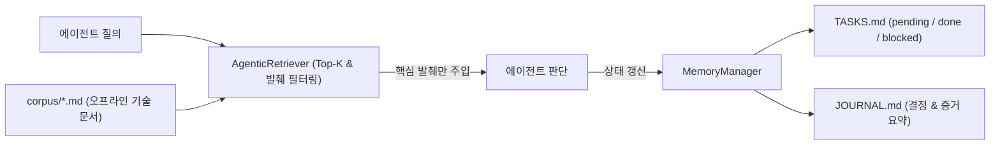

# 제5장 (`ch05-rag-and-memory`) — 외부 지식(RAG)과 세션 너머의 기억(Memory)

## 1. 단원 학습 목표 & 12대 스택 4계층 위치

- **학습 목표 1**: 전체 문서를 한 번에 넣지 않고 쿼리에 따라 필요한 발췌만 선별하는 **Agentic RAG 사서 패턴**(`Top-K`, `max_chars_per_excerpt`)을 구현한다.
- **학습 목표 2**: 대화가 끝나도 상태가 사라지지 않도록 `TASKS.md`와 `JOURNAL.md`에 작업 상태와 핵심 결정·증거를 기록하는 **지속 Memory 관리자**를 구현한다.
- **학습 목표 3**: `ch05-rag-and-memory/` 폴더로 이동해 AI CLI에서 사용자 프롬프트로 하이브리드 검색과 지속 메모리 상태를 조회·검증한다.

| 계층 | 스택 요소 | 본 단원 구현 |
| :--- | :--- | :--- |
| **Layer 1: 지식과 기억** | ③ Agentic RAG & 지속 Memory | `agentic_rag.py`, `memory_manager.py`, `TASKS.md`, `JOURNAL.md`, `corpus/` |

## 2. 아키텍처 다이어그램 (Mermaid)



## 3. 디렉터리 및 소스 파일 구조

- 정식 구현 경로 (챕터 루트): `ch05-rag-and-memory/`
- 도서 `💻 Git 예제` 호환 경로: `ch05/memory_pattern/` (`../ch05-rag-and-memory` 심볼릭 링크)

```text
ch05-rag-and-memory/
├── README.md
├── AGENTS.md
├── CLAUDE.md
├── GEMINI.md
├── .claude/rules/rag-memory.md
├── .gemini/
├── memory_manager.py
├── agentic_rag.py
├── TASKS.md
├── JOURNAL.md
├── corpus/
│   ├── 01_context_budget.md
│   ├── 02_agentic_rag.md
│   ├── 03_durable_memory.md
│   └── 04_harness_guardrails.md
└── tests/
    └── test_memory_pattern.py
```

## 4. 실습 방식 & 사용자 입력 프롬프트 예시 (AI CLI)

### 4.1 실습 절차 (챕터 루트 이동 후 AI CLI 접속)

```bash
cd ch05-rag-and-memory
claude   # 또는 agy / codex
```

### 4.2 사용자 입력 프롬프트 예시 (3개 이상)

- **프롬프트 예시 1 (Agentic RAG 코퍼스 발췌 검색)**:
  > "현재 `ch05-rag-and-memory` 폴더에서 `python3 agentic_rag.py`를 실행해 `corpus/` 내 4종 기술 문서에서 질의별 상위 매칭 문서와 발췌 결과를 출력해줘."

- **프롬프트 예시 2 (세션 간 지속 메모리 `TASKS.md` · `JOURNAL.md` 상태 진단)**:
  > "`python3 memory_manager.py --status --json`을 실행해 `TASKS.md`의 완료/대기 태스크 수와 `JOURNAL.md` 기록 건수를 JSON으로 출력하고 다음 대기 태스크를 알려줘."

- **프롬프트 예시 3 (RAG 발췌 상한 및 지속 메모리 단위 테스트)**:
  > "`tests/test_memory_pattern.py` 단위 테스트를 실행해 `Top-K` 발췌 길이 제한과 `TASKS.md`/`JOURNAL.md` 상태 전이가 모두 통과하는지 확인해줘."

### 4.3 참고용 직접 실행 명령어

```bash
python3 agentic_rag.py
python3 memory_manager.py --status --json
python3 -m unittest discover -s tests -p "test_*.py" -v
```

## 5. 핵심 체크리스트

- [ ] `ch05-rag-and-memory/` 루트에 `AGENTS.md`, `CLAUDE.md`, `GEMINI.md`, `.claude/`, `.gemini/`가 존재하는가?
- [ ] `MemoryManager`가 `TASKS.md`의 대기 태스크를 파싱하고 `--status --json`으로 상태를 출력하는가?
- [ ] `AgenticRetriever.search()`가 `top_k`와 `max_chars_per_excerpt` 상한을 엄격히 지키는가?
