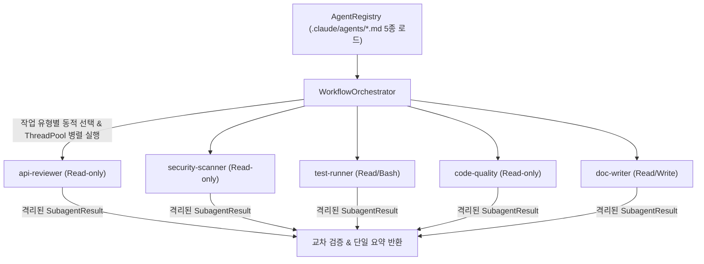

# 제5장 (`ch05-subagents-workflow`) — 혼자 다 하지 않는 기술: 서브에이전트와 워크플로

## 1. 단원 학습 목표 & 12대 스택 4계층 위치

- **학습 목표 1**: 단일 컨텍스트에서 모든 역할을 수행할 때 생기는 오염을 막기 위해 **커스텀 서브에이전트 5종**(`.claude/agents/*.md`)을 읽기 전용/실행형으로 분리한다.
- **학습 목표 2**: 작업 유형에 따라 서브에이전트를 동적으로 선택하고 `ThreadPoolExecutor`로 격리 컨텍스트 병렬 실행 후 단일 요약으로 병합한다.
- **학습 목표 3**: `ch05-subagents-workflow/` 폴더로 이동해 AI CLI에서 사용자 프롬프트로 동적 병렬 워크플로와 확장된 `quote_cli.py`(`--search`, `--author`)를 실행한다.

| 계층 | 스택 요소 | 본 단원 구현 |
| :--- | :--- | :--- |
| **Layer 4: 위임과 검증** | ⑩ 서브에이전트 & 동적 워크플로 | `.claude/agents/*.md` 5종, `dynamic_workflow.py`, 검색 확장 `quote_cli.py` |

## 2. 아키텍처 다이어그램 (Mermaid)



## 3. 디렉터리 및 소스 파일 구조

- 정식 구현 경로 (챕터 루트): `ch05-subagents-workflow/`

```text
ch05-subagents-workflow/
├── README.md
├── AGENTS.md
├── CLAUDE.md
├── GEMINI.md
├── .claude/
│   ├── agents/              # api-reviewer, test-runner, security-scanner, code-quality, doc-writer
│   └── rules/subagents.md
├── .gemini/
├── agents_chatgpt.json · agents_gemini.json
├── dynamic_workflow.py
├── quote_cli.py             # --search, --author, --tag, --all, --json
├── quotes.json
└── tests/
    ├── test_dynamic_workflow.py
    └── test_quote_cli_search.py
```

## 4. 실습 방식 & 사용자 입력 프롬프트 예시 (AI CLI)

### 4.1 실습 절차 (챕터 루트 이동 후 AI CLI 접속)

```bash
cd ch05-subagents-workflow
claude   # 또는 agy / codex
```

### 4.2 사용자 입력 프롬프트 예시 (3개 이상)

- **프롬프트 예시 1 (동적 서브에이전트 선택 및 격리 병렬 워크플로 실행)**:
  > "현재 `ch05-subagents-workflow` 폴더에서 `python3 dynamic_workflow.py --task-type api_change --platform gemini --json`을 실행해 동적 선택된 서브에이전트 목록과 교차 검증(`cross_verified`) 결과를 출력해줘."

- **프롬프트 예시 2 (검색 기능이 확장된 `quote_cli.py` 실행)**:
  > "`python3 quote_cli.py --search 'harness' --json`과 `python3 quote_cli.py --author 'Loop' --json`을 실행해 키워드 및 저자 검색 결과를 확인해줘."

- **프롬프트 예시 3 (5종 서브에이전트 권한 분리 및 통합 테스트 검증)**:
  > "`.claude/agents/` 5종 서브에이전트의 읽기 전용(`read_only`) 도구 제약을 점검하고 `python3 -m unittest discover -s tests -p 'test_*.py' -v` 실행 결과를 출력해줘."

### 4.3 참고용 직접 실행 명령어

```bash
python3 dynamic_workflow.py --task-type api_change --platform gemini --json
python3 quote_cli.py --search "harness" --json
python3 -m unittest discover -s tests -p "test_*.py" -v
```

## 5. 핵심 체크리스트

- [ ] `ch05-subagents-workflow/` 루트에 `AGENTS.md`, `CLAUDE.md`, `GEMINI.md`, `.claude/agents/`, `.gemini/`가 모두 구성되어 있는가?
- [ ] `api-reviewer`, `security-scanner`, `code-quality`가 읽기 전용 도구(`Read`, `Grep`, `Glob`)만 보유하는가?
- [ ] `WorkflowOrchestrator`가 각 서브에이전트 결과를 격리 실행 후 단일 요약으로 병합하는가?
