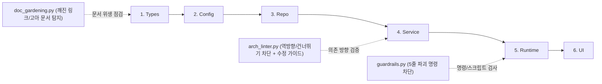

# 제6장 (`ch06-harness-engineering`) — 모델을 감싸는 안전장치: 하네스 엔지니어링

## 1. 단원 학습 목표 & 12대 스택 4계층 위치

- **학습 목표 1**: 하네스 설계 4대 질문(무엇을 막을 것인가 / 보여줄 것인가 / 줄 것인가 / 갈아 끼울 것인가)을 반영한 **100줄 이하 목차형 `AGENTS.md`**를 설계한다.
- **학습 목표 2**: 계층 역방향/건너뛰기 의존을 탐지하고 **"여기가 틀렸으니 이렇게 고쳐라"** 수정 가이드를 출력하는 `arch_linter.py`를 구현한다.
- **학습 목표 3**: `ch06-harness-engineering/` 폴더로 이동해 AI CLI에서 사용자 프롬프트로 아키텍처 린터, 5줄 가드레일(`guardrails.py`), 문서 정원 가꾸기(`doc_gardening.py`)를 실행한다.

| 계층 | 스택 요소 | 본 단원 구현 |
| :--- | :--- | :--- |
| **Layer 3: 표준과 확장** | ⑨ 하네스 엔지니어링 | `AGENTS.md` (<=100줄), `arch_linter.py`, `guardrails.py`, `doc_gardening.py` |

## 2. 아키텍처 다이어그램 (Mermaid)



## 3. 디렉터리 및 소스 파일 구조

- 정식 구현 경로 (챕터 루트): `ch06-harness-engineering/`

```text
ch06-harness-engineering/
├── README.md
├── AGENTS.md                  # 100줄 이하 목차형 템플릿 (4대 질문 포함)
├── CLAUDE.md
├── GEMINI.md
├── .claude/rules/harness.md
├── .gemini/
├── arch_linter.py             # 6계층 의존성 린터
├── guardrails.py              # 5줄 가드레일 검사기 (--json)
├── doc_gardening.py           # 문서 정원 가꾸기 도구
├── samples/{valid_app,invalid_app}/
└── tests/
    └── test_harness_templates.py
```

## 4. 실습 방식 & 사용자 입력 프롬프트 예시 (AI CLI)

### 4.1 실습 절차 (챕터 루트 이동 후 AI CLI 접속)

```bash
cd ch06-harness-engineering
claude   # 또는 agy / codex
```

### 4.2 사용자 입력 프롬프트 예시 (3개 이상)

- **프롬프트 예시 1 (정상 앱 vs 계층 위반 앱 AST 아키텍처 린터 비교)**:
  > "현재 `ch06-harness-engineering` 폴더에서 `arch_linter.py`로 `samples/valid_app`과 `samples/invalid_app`을 각각 검사(`--json`)하고, 탐지된 역방향/건너뛰기 의존 위반과 수정 가이드를 비교해줘."

- **프롬프트 예시 2 (5줄 파괴 명령 가드레일 점검)**:
  > "`guardrails.py --cmd 'ls -la' --json`과 `guardrails.py --cmd 'rm -rf /' --json`을 각각 실행해 안전 명령 통과와 파괴 명령 차단 결과를 출력해줘."

- **프롬프트 예시 3 (문서 정원 가꾸기 및 하네스 전체 단위 테스트)**:
  > "`doc_gardening.py --root samples/invalid_app --json`으로 고아 문서와 깨진 링크를 탐지한 뒤, `tests/test_harness_templates.py` 전체 단위 테스트를 실행해줘."

### 4.3 참고용 직접 실행 명령어

```bash
python3 arch_linter.py --root samples/valid_app --json
python3 guardrails.py --cmd "ls -la" --json
python3 doc_gardening.py --root samples/valid_app --json
python3 -m unittest discover -s tests -p "test_*.py" -v
```

## 5. 핵심 체크리스트

- [ ] `ch06-harness-engineering/` 루트에 `AGENTS.md`(100줄 이하, 4대 질문 포함), `CLAUDE.md`, `GEMINI.md`, `.claude/`, `.gemini/`가 존재하는가?
- [ ] `arch_linter.py`가 역방향·계층 건너뛰기 위반 시 수정 가이드와 non-zero exit code를 반환하는가?
- [ ] `guardrails.py`와 `doc_gardening.py`가 정상/위반 샘플을 정확히 구별하는가?
