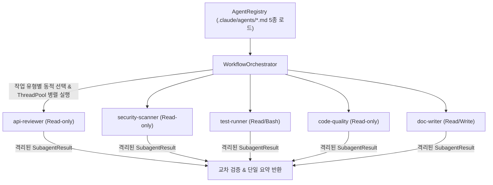

# 제6장 (`ch06-subagents-workflow`) — 혼자 다 하지 않는 기술: 서브에이전트와 워크플로

## 1. 단원 학습 목표 & 12대 스택 4계층 위치

- **학습 목표 1**: 단일 컨텍스트에서 모든 역할을 수행할 때 생기는 오염을 막기 위해 **커스텀 서브에이전트 5종**(`.claude/agents/*.md`)을 읽기 전용/실행형으로 분리한다.
- **학습 목표 2**: 작업 유형에 따라 서브에이전트를 동적으로 선택하고 `ThreadPoolExecutor`로 격리 컨텍스트 병렬 실행 후 단일 요약으로 병합한다.
- **학습 목표 3**: 제1장 `quote-cli`에 키워드(`--search`), 작성자(`--author`), 태그(`--tag`) 검색 기능을 확장한다.

| 계층 | 스택 요소 | 본 단원 구현 |
| :--- | :--- | :--- |
| **Layer 4: 위임과 검증** | ⑩ 서브에이전트 & 동적 워크플로 | `.claude/agents/*.md` 5종, `dynamic_workflow.py`, 확장 `quote-cli/` |

## 2. 아키텍처 다이어그램 (Mermaid)



## 3. 디렉터리 및 소스 파일 구조

- 정식 구현 경로: `ch06-subagents-workflow/`
- 도서 `💻 Git 예제` 호환 경로: `ch06/quote-cli/` (`../ch06-subagents-workflow/quote-cli` 심볼릭 링크 + 내부 `.claude -> ../.claude`)

```text
ch06-subagents-workflow/
├── README.md
├── .claude/agents/          # api-reviewer, test-runner, security-scanner, code-quality, doc-writer
├── quote-cli/
│   ├── .claude -> ../.claude
│   ├── quotes.json
│   ├── quote_cli.py         # --search, --author, --tag, --all, --json
│   └── tests/test_quote_cli_search.py
├── dynamic_workflow.py
└── tests/test_dynamic_workflow.py
```

## 4. 컨테이너 실행 & 테스트 명령어

```bash
# 검색 확장 quote-cli 실행
python3 ch06-subagents-workflow/quote-cli/quote_cli.py --search "harness" --json
python3 ch06/quote-cli/quote_cli.py --author "Hermes"

# 동적 병렬 워크플로 실행
python3 ch06-subagents-workflow/dynamic_workflow.py --task-type api_change --json

# 단위 테스트 및 Phase 4 검증
python3 -m unittest discover -s ch06-subagents-workflow/quote-cli/tests -p "test_*.py"
python3 -m unittest discover -s ch06-subagents-workflow/tests -p "test_*.py"
python3 scripts/verify_chapters.py --chapter ch06
```

## 5. 핵심 체크리스트

- [ ] `.claude/agents/` 아래 5종 서브에이전트 모두 YAML frontmatter(`name`, `description`, `tools`, `model`)를 갖추었는가?
- [ ] `api-reviewer`, `security-scanner`, `code-quality`가 읽기 전용 도구(`Read`, `Grep`, `Glob`)만 보유하는가?
- [ ] `WorkflowOrchestrator`가 각 서브에이전트 결과를 격리 저장 후 교차 검증·단일 요약으로 병합하는가?
