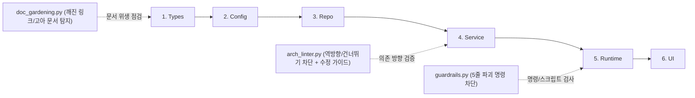

# 제7장 (`ch07-harness-engineering`) — 모델을 감싸는 안전장치: 하네스 엔지니어링

## 1. 단원 학습 목표 & 12대 스택 4계층 위치

- **학습 목표 1**: 하네스 설계 4대 질문(무엇을 막을 것인가 / 보여줄 것인가 / 줄 것인가 / 갈아 끼울 것인가)을 반영한 **100줄 이하 목차형 `AGENTS.md`**를 설계한다.
- **학습 목표 2**: 계층 역방향/건너뛰기 의존을 탐지하고 **"여기가 틀렸으니 이렇게 고쳐라"** 수정 가이드를 출력하는 `arch_linter.py`를 구현한다.
- **학습 목표 3**: 파괴적 명령 5줄 가드레일(`guardrails.py`)과 깨진 링크·고아 문서를 정리하는 문서 정원 가꾸기(`doc_gardening.py`)를 자동화한다.

| 계층 | 스택 요소 | 본 단원 구현 |
| :--- | :--- | :--- |
| **Layer 3: 표준과 확장** | ⑨ 하네스 엔지니어링 | `AGENTS.md` (<=100줄), `arch_linter.py`, `guardrails.py`, `doc_gardening.py` |

## 2. 아키텍처 다이어그램 (Mermaid)



## 3. 디렉터리 및 소스 파일 구조

- 정식 구현 경로: `ch07-harness-engineering/harness-templates/`
- 도서 `💻 Git 예제` 호환 경로: `ch07/harness-templates/` (`../ch07-harness-engineering/harness-templates` 심볼릭 링크)

```text
ch07-harness-engineering/
├── README.md
└── harness-templates/
    ├── AGENTS.md              # 100줄 이하 목차형 템플릿
    ├── arch_linter.py         # 6계층 의존성 린터
    ├── guardrails.py          # 5줄 가드레일 검사기
    ├── doc_gardening.py       # 문서 정원 가꾸기 도구
    ├── samples/{valid_app,invalid_app}/
    └── tests/test_harness_templates.py
```

## 4. 컨테이너 실행 & 테스트 명령어

```bash
# 아키텍처 린터 정상/위반 샘플 실행
python3 ch07-harness-engineering/harness-templates/arch_linter.py --root ch07-harness-engineering/harness-templates/samples/valid_app
python3 ch07-harness-engineering/harness-templates/doc_gardening.py --root ch07-harness-engineering/harness-templates/samples/valid_app

# 단위 테스트 및 Phase 4 검증
python3 -m unittest discover -s ch07-harness-engineering/harness-templates/tests -p "test_*.py"
python3 scripts/verify_chapters.py --chapter ch07
```

## 5. 핵심 체크리스트

- [ ] `harness-templates/AGENTS.md`가 100줄 이하 목차형이며 하네스 4대 질문을 포함하는가?
- [ ] `arch_linter.py`가 역방향·계층 건너뛰기 위반 시 수정 가이드와 non-zero exit code를 반환하는가?
- [ ] `guardrails.py`와 `doc_gardening.py`가 정상/위반 샘플을 정확히 구별하는가?
