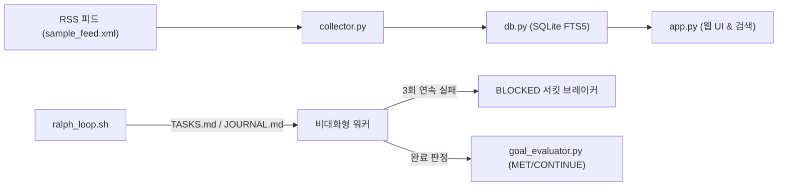

# 제7장 (`ch07-inner-ralph-loop`) — 스스로 고치는 최소 단위: 이너 루프와 랄프 루프

## 1. 단원 학습 목표 & 12대 스택 4계층 위치

- **학습 목표 1**: One-shot 요청을 넘어 완료 조건 충족 시까지 자가 수정하는 **이너 루프(Inner Loop)** 구조를 이해한다.
- **학습 목표 2**: SQLite FTS5, RSS 수집기, 웹 UI(`app.py`)로 구성된 **RSS Wiki** 지식 생성 시스템을 구현한다.
- **학습 목표 3**: `ch07-inner-ralph-loop/` 폴더로 이동해 AI CLI에서 사용자 프롬프트로 `ralph_loop.sh` 서킷 브레이커와 `/goal` 독립 완료 판정기(`goal_evaluator.py`)를 검증한다.

| 계층 (Layer) | 12대 스택 요소 | 본 단원의 핵심 구현 |
| :--- | :--- | :--- |
| **Layer 4. 위임과 검증** | ⑪ 이너 루프 & 자가 수정 | `ralph_loop.sh`, `goal_evaluator.py`, SQLite FTS5 `db.py`, `collector.py`, `app.py` |

## 2. 아키텍처 다이어그램 (Mermaid)



## 3. 디렉터리 및 소스 파일 구조

- 정식 구현 경로 (챕터 루트): `ch07-inner-ralph-loop/`

```text
ch07-inner-ralph-loop/
├── README.md
├── AGENTS.md
├── CLAUDE.md
├── GEMINI.md
├── .claude/rules/ralph-loop.md
├── .gemini/
├── PROMPT.md
├── db.py
├── collector.py
├── app.py
├── sample_feed.xml
├── templates/ (index.html, article.html, search.html, wiki.html)
├── goal_evaluator.py
├── ralph_loop.sh
├── worker_claude.sh · worker_chatgpt.sh · worker_gemini.sh
└── tests/
    └── test_rss_wiki.py
```

## 4. 실습 방식 & 사용자 입력 프롬프트 예시 (AI CLI)

### 4.1 실습 절차 (챕터 루트 이동 후 AI CLI 접속)

```bash
cd ch07-inner-ralph-loop
claude   # 또는 agy / codex
```

### 4.2 사용자 입력 프롬프트 예시 (3개 이상)

- **프롬프트 예시 1 (`/goal` 독립 목표 달성 평가기 실행)**:
  > "현재 `ch07-inner-ralph-loop` 폴더에서 `python3 goal_evaluator.py`를 실행해 `PROMPT.md`의 5대 완료 조건(`status: MET`, `passed_count: 5/5`) 달성 여부를 JSON으로 출력해줘."

- **프롬프트 예시 2 (SQLite FTS5 RSS 수집 및 전문 검색 검증)**:
  > "`sample_feed.xml`을 `collector.py`로 파싱해 SQLite FTS5(`db.py`)에 색인한 뒤 키워드 검색과 웹 UI 엔드포인트(`app.py`) 응답이 정상인지 테스트해줘."

- **프롬프트 예시 3 (Ralph Loop 3회 연속 실패 서킷 브레이커 및 단위 테스트 검증)**:
  > "`ralph_loop.sh`의 3회 연속 실패 시 `[BLOCKED]` 서킷 브레이커 동작을 포함한 `tests/test_rss_wiki.py` 전체 단위 테스트를 실행해 결과를 요약해줘."

### 4.3 참고용 직접 실행 명령어

```bash
python3 goal_evaluator.py
python3 -m unittest discover -s tests -p "test_*.py" -v
```

## 5. 핵심 체크리스트

- [ ] `ch07-inner-ralph-loop/` 루트에 `AGENTS.md`, `CLAUDE.md`, `GEMINI.md`, `.claude/`, `.gemini/`가 존재하는가?
- [ ] 동일 태스크가 3회 연속 실패하면 `[BLOCKED]`로 마킹하고 서킷 브레이커가 루프를 중단하는가?
- [ ] `/goal` 판정기(`goal_evaluator.py`)는 구현 주체와 분리되어 객관적 조건으로만 `MET`를 반환하는가?
