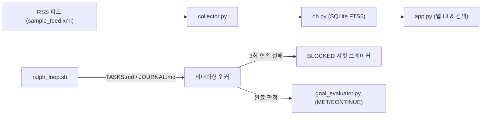

# 제8장. 스스로 고치는 최소 단위: 이너 루프와 랄프 루프

## 1. 단원 학습 목표 & 12대 스택 4계층 위치

- **학습 목표 1**: One-shot 요청을 넘어 완료 조건 충족 시까지 자가 수정하는 **이너 루프(Inner Loop)** 구조를 이해한다.
- **학습 목표 2**: SQLite FTS5, RSS 수집기, 웹 UI(`app.py`)로 구성된 **RSS Wiki** 지식 생성 시스템을 구현한다.
- **학습 목표 3**: 파일 기반 상태 인계(`TASKS.md`, `JOURNAL.md`)와 **3회 연속 실패 시 `BLOCKED` 서킷 브레이커**를 갖춘 `ralph_loop.sh`를 실행한다.
- **학습 목표 4**: 작성자와 채점 모델을 분리한 `/goal` 독립 완료 판정(`goal_evaluator.py`) 원리를 검증한다.

| 계층 (Layer) | 12대 스택 요소 | 본 단원의 핵심 구현 |
| :--- | :--- | :--- |
| **Layer 4. 위임과 검증** | ⑪ 이너 루프 & 자가 수정 | `rss-wiki/ralph_loop.sh`, `goal_evaluator.py`, SQLite FTS5 `db.py` |

## 2. 아키텍처 다이어그램 (Mermaid)



## 3. 디렉터리 및 소스 파일 구조

- 정식 경로: `ch08-inner-ralph-loop/rss-wiki/`
- 도서 본문 `💻 Git 예제` 호환 경로: `ch08/rss-wiki/` (`-> ../ch08-inner-ralph-loop/rss-wiki`)

| 파일 | 역할 |
| :--- | :--- |
| `rss-wiki/db.py` | SQLite FTS5 전문 검색(`articles_fts`) 및 위키 저장소 |
| `rss-wiki/collector.py` | 오프라인 XML 지원 RSS/Atom 수집기 + `sample_feed.xml` |
| `rss-wiki/app.py` | `FastAPI+Jinja2` (및 내장 `MiniWebApp` 폴백) 웹 UI & `get_test_client()` |
| `rss-wiki/ralph_loop.sh` | `TASKS.md`/`JOURNAL.md` 반복 루프 및 3회 연속 실패 `BLOCKED` 서킷 브레이커 |
| `rss-wiki/goal_evaluator.py` | `/goal` 독립 완료 판정 시뮬레이터 (`MET`/`CONTINUE`/`BLOCKED`) |
| `rss-wiki/tests/test_rss_wiki.py` | FTS5, 수집기, 웹 UI HTTP 200, 랄프 루프 서킷 브레이커, `/goal` 단위 테스트 |

## 4. 컨테이너 실행 & 테스트 명령어

```bash
cd /apps/learn_hermes_engineering
python3 ch08-inner-ralph-loop/rss-wiki/goal_evaluator.py --target ch08-inner-ralph-loop/rss-wiki
python3 -m unittest discover -s ch08-inner-ralph-loop/rss-wiki/tests -p "test_*.py" -v
python3 scripts/verify_chapters.py --phase 4
```

## 5. 핵심 체크리스트

- [ ] `ralph_loop.sh`는 매 반복마다 새 컨텍스트로 시작하고 상태를 `TASKS.md`/`JOURNAL.md`에 남기는가?
- [ ] 동일 태스크가 3회 연속 실패하면 `[BLOCKED]`로 마킹하고 서킷 브레이커가 루프를 중단하는가?
- [ ] `/goal` 판정기(`goal_evaluator.py`)는 구현 주체와 분리되어 객관적 조건으로만 `MET`를 반환하는가?
