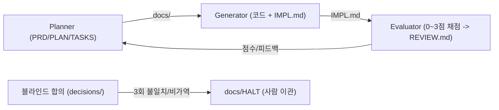

# 제9장 (`ch09-orchestration`) — 다중 에이전트 지휘: 오케스트레이션

## 1. 단원 학습 목표 & 12대 스택 4계층 위치

- **학습 목표 1**: 단일 에이전트의 긍정 편향을 제거하는 **3-Agent(Planner-Generator-Evaluator) 역할 분리**를 구현한다.
- **학습 목표 2**: 대화 컨텍스트 전달 대신 `docs/` 마크다운 파일을 매개로 협업하는 **파일 매개 협업**을 설계한다.
- **학습 목표 3**: `ch09-orchestration/` 폴더로 이동해 AI CLI에서 사용자 프롬프트로 첫 줄(`선택: A`) **블라인드 합의**와 0~3점 척도 루브릭 채점표를 실행한다.

| 계층 (Layer) | 12대 스택 요소 | 본 단원의 핵심 구현 |
| :--- | :--- | :--- |
| **Layer 4. 위임과 검증** | ⑪ 오케스트레이션 | `run.py`, `src/harness/permissions.py`, `consensus.py`, `rubric.py`, `orchestrator.py` |

## 2. 아키텍처 다이어그램 (Mermaid)



## 3. 디렉터리 및 소스 파일 구조

- 정식 구현 경로 (챕터 루트): `ch09-orchestration/`
- 도서 본문 `💻 Git 예제` 호환 경로: `ch09/harness/` (`-> ../ch09-orchestration` 심볼릭 링크)

```text
ch09-orchestration/
├── README.md
├── AGENTS.md
├── CLAUDE.md
├── GEMINI.md
├── .claude/rules/orchestration.md
├── .gemini/
├── pyproject.toml
├── run.py
├── src/harness/
│   ├── __init__.py
│   ├── orchestrator.py
│   ├── consensus.py
│   ├── rubric.py
│   ├── permissions.py
│   └── prompts/ (planner.md, generator.md, evaluator.md, planner_bootstrap.md)
└── tests/
    └── test_orchestration_harness.py
```

## 4. 실습 방식 & 사용자 입력 프롬프트 예시 (AI CLI)

### 4.1 실습 절차 (챕터 루트 이동 후 AI CLI 접속)

```bash
cd ch09-orchestration
claude   # 또는 agy / codex
```

### 4.2 사용자 입력 프롬프트 예시 (3개 이상)

- **프롬프트 예시 1 (3-Agent 오케스트레이션 및 블라인드 합의 시뮬레이션)**:
  > "현재 `ch09-orchestration` 폴더에서 `python3 run.py --mode sim --platform chatgpt`를 실행해 Planner·Generator·Evaluator 파일 매개 협업과 블라인드 합의 결과 JSON을 출력해줘."

- **프롬프트 예시 2 (역할별 도구 권한 분리 및 0~3점 루브릭 채점 점검)**:
  > "`src/harness/permissions.py`의 역할별 권한 매트릭스와 `src/harness/rubric.py`의 UI 포함(15점)/비UI(12점) 채점 기준을 확인하고 합격(`PASS`) 판정 조건을 설명해줘."

- **프롬프트 예시 3 (3회 합의 불일치 `docs/HALT` 에스컬레이션 테스트)**:
  > "`tests/test_orchestration_harness.py` 단위 테스트를 실행해 권한 위반 차단, 블라인드 합의 3회 불일치 시 `docs/HALT` 생성, 루브릭 채점이 모두 통과하는지 검증해줘."

### 4.3 참고용 직접 실행 명령어

```bash
python3 run.py --mode sim --platform chatgpt
python3 -m unittest discover -s tests -p "test_*.py" -v
```

## 5. 핵심 체크리스트

- [ ] `ch09-orchestration/` 루트에 `AGENTS.md`, `CLAUDE.md`, `GEMINI.md`, `.claude/`, `.gemini/`가 존재하는가?
- [ ] Planner, Generator, Evaluator의 도구 권한이 코드 레벨(`permissions.py`)로 분리되어 있는가?
- [ ] 블라인드 합의 3회 불일치 또는 `irreversible=True` 시 `docs/HALT`가 생성되는가?
