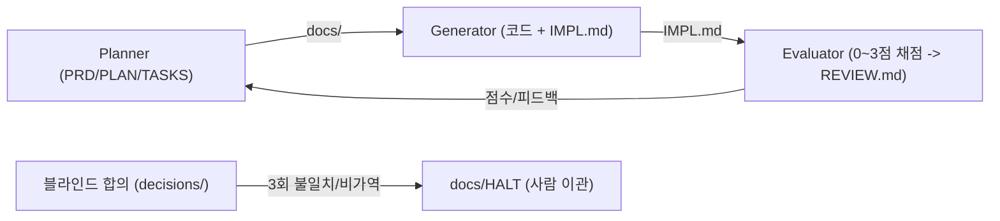

# 제9장. 다중 에이전트 지휘: 오케스트레이션

## 1. 단원 학습 목표 & 12대 스택 4계층 위치

- **학습 목표 1**: 단일 에이전트의 긍정 편향을 제거하는 **3-Agent(Planner-Generator-Evaluator) 역할 분리**를 구현한다.
- **학습 목표 2**: 대화 컨텍스트 전달 대신 `docs/` 마크다운 파일을 매개로 협업하는 **파일 매개 협업**을 설계한다.
- **학습 목표 3**: 첫 줄 `선택: A` 파싱 기반 **블라인드 합의**와 3회 불일치·비가역 결정 시 `docs/HALT` 생성을 구현한다.
- **학습 목표 4**: 0~3점 척도 정량 채점표(UI 포함 15점 / 비UI 12점 만점)로 품질 하한선을 통제한다.

| 계층 (Layer) | 12대 스택 요소 | 본 단원의 핵심 구현 |
| :--- | :--- | :--- |
| **Layer 4. 위임과 검증** | ⑪ 오케스트레이션 | `harness/run.py`, `permissions.py`, `consensus.py`, `rubric.py`, `orchestrator.py` |

## 2. 아키텍처 다이어그램 (Mermaid)



## 3. 디렉터리 및 소스 파일 구조

- 정식 경로: `ch09-orchestration/harness/`
- 도서 본문 `💻 Git 예제` 호환 경로: `ch09/harness/` (`-> ../ch09-orchestration/harness`)

| 파일 | 역할 |
| :--- | :--- |
| `harness/pyproject.toml` | `harness` 패키지 메타데이터 |
| `harness/run.py` | 결정적 3-Agent 오케스트레이션 CLI (`--mode sim`) |
| `harness/src/harness/prompts/*.md` | `planner.md`, `generator.md`, `evaluator.md`, `planner_bootstrap.md` |
| `harness/src/harness/permissions.py` | 역할별 도구 권한(`Read/Write/Bash`) 분리 및 위반 검사기 |
| `harness/src/harness/consensus.py` | 블라인드 합의 첫 줄 `선택: A` 파서 및 `docs/HALT` 생성기 |
| `harness/src/harness/rubric.py` | 0~3점 척도 정량 채점표 (15점 / 12점 만점) |
| `harness/src/harness/orchestrator.py` | `PRD -> PLAN -> TASKS -> IMPL -> REVIEW` 파일 매개 루프 엔진 |

## 4. 컨테이너 실행 & 테스트 명령어

```bash
cd /apps/learn_hermes_engineering
python3 ch09-orchestration/harness/run.py --mode sim
python3 -m unittest discover -s ch09-orchestration/harness/tests -p "test_*.py" -v
```

## 5. 핵심 체크리스트

- [ ] Planner, Generator, Evaluator의 도구 권한이 코드 레벨(`permissions.py`)로 분리되어 있는가?
- [ ] 블라인드 합의 3회 불일치 또는 `irreversible=True` 시 `docs/HALT`가 생성되는가?
- [ ] `rubric.py`가 UI 유무(15점/12점)에 따라 `PASS`/`CONDITIONAL_PASS`/`FAIL`을 정확히 판정하는가?
