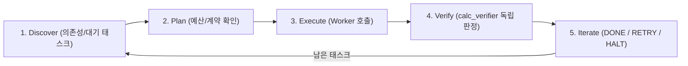

# 제10장 (`ch10-outer-loop`) — 장기 실행의 완성: 아우터 루프 엔지니어링

## 1. 단원 학습 목표 & 12대 스택 4계층 위치

- **학습 목표 1**: 루프 엔지니어링 8대 결정과 **5단계 운영 루프(`Discover→Plan→Execute→Verify→Iterate`)**를 구현한다.
- **학습 목표 2**: 성공·품질·안정성과 반복·시간·비용·실패·인간 이관(`HALT`)을 포괄하는 **7대 완료·중단 조건**을 코드로 검증한다.
- **학습 목표 3**: `ch10-outer-loop/` 폴더로 이동해 AI CLI에서 사용자 프롬프트로 `CALC-001`~`CALC-004` 계약 태스크와 독립 검증기(`calc_verifier.py`), 비용 로거(`cost_logger.py`)를 실행한다.

| 계층 (Layer) | 12대 스택 요소 | 본 단원의 핵심 구현 |
| :--- | :--- | :--- |
| **Layer 4. 위임과 검증** | ⑪ 아우터 루프 엔지니어링 | `loop.py`, `models.py`, `workers.py`, `cost_logger.py`, `sample_tasks/` |

## 2. 아키텍처 다이어그램 (Mermaid)



## 3. 디렉터리 및 소스 파일 구조

- 정식 구현 경로 (챕터 루트): `ch10-outer-loop/`
- 도서 본문 `💻 Git 예제` 호환 경로: `ch10/todo-loop/` (`-> ../ch10-outer-loop` 심볼릭 링크)

```text
ch10-outer-loop/
├── README.md
├── AGENTS.md
├── CLAUDE.md
├── GEMINI.md
├── .claude/rules/outer-loop.md
├── .gemini/
├── loop.py
├── models.py
├── workers.py
├── cost_logger.py
├── sample_tasks/
│   ├── tasks_contract.json
│   └── calc_verifier.py
└── tests/
    └── test_todo_loop.py
```

## 4. 실습 방식 & 사용자 입력 프롬프트 예시 (AI CLI)

### 4.1 실습 절차 (챕터 루트 이동 후 AI CLI 접속)

```bash
cd ch10-outer-loop
claude   # 또는 agy / codex
```

### 4.2 사용자 입력 프롬프트 예시 (3개 이상)

- **프롬프트 예시 1 (5단계 아우터 루프 실행 및 태스크 상태 전이 확인)**:
  > "현재 `ch10-outer-loop` 폴더에서 `python3 loop.py --platform claude`를 실행해 `CALC-001`~`CALC-004` 태스크의 완료/중단 상태(`completed_tasks`, `halted_tasks`, `stop_reason`)와 누적 비용 JSON을 출력해줘."

- **프롬프트 예시 2 (거짓 완료 방지 독립 검증기 `calc_verifier.py` 점검)**:
  > "`sample_tasks/tasks_contract.json`과 `sample_tasks/calc_verifier.py`를 분석해 `CALC-002` 1차 실패 후 재시도 통과 과정과 `CALC-003` 외부 의사결정 부재 시 `HALT` 전이 규칙을 설명해줘."

- **프롬프트 예시 3 (7대 완료·중단 조건 및 비용 로거 단위 테스트)**:
  > "`tests/test_todo_loop.py` 단위 테스트를 실행해 인간 이관(`HALT`), 의존성 순서(`depends_on`), JSONL 비용 로깅이 모두 정상 통과하는지 검증해줘."

### 4.3 참고용 직접 실행 명령어

```bash
python3 loop.py --platform claude
python3 -m unittest discover -s tests -p "test_*.py" -v
```

## 5. 핵심 체크리스트

- [ ] `ch10-outer-loop/` 루트에 `AGENTS.md`, `CLAUDE.md`, `GEMINI.md`, `.claude/`, `.gemini/`가 존재하는가?
- [ ] `CALC-001`(정상 완료), `CALC-002`(재시도 성공), `CALC-003`(`HALT`), `CALC-004`(`depends_on` 제어)가 모두 검증되는가?
- [ ] 워커가 `completed`를 반환해도 `calc_verifier.py`가 독립적으로 최종 합격을 판정하는가?
