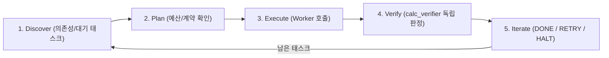

# 제10장. 장기 실행의 완성: 아우터 루프 엔지니어링

## 1. 단원 학습 목표 & 12대 스택 4계층 위치

- **학습 목표 1**: 루프 엔지니어링 8대 결정과 **5단계 운영 루프(`Discover→Plan→Execute→Verify→Iterate`)**를 구현한다.
- **학습 목표 2**: 성공·품질·안정성과 반복·시간·비용·실패·인간 이관(`HALT`)을 포괄하는 **7대 완료·중단 조건**을 코드로 검증한다.
- **학습 목표 3**: 워커의 자체 완료 선언(`completed`)과 분리된 **독립 검증기(`calc_verifier.py`)**로 거짓 완료를 차단한다.
- **학습 목표 4**: `CALC-001`~`CALC-004` 시나리오와 `cost_logger.py`를 통해 비용 통제와 의존성 제어를 실습한다.

| 계층 (Layer) | 12대 스택 요소 | 본 단원의 핵심 구현 |
| :--- | :--- | :--- |
| **Layer 4. 위임과 검증** | ⑪ 아우터 루프 엔지니어링 | `todo-loop/loop.py`, `models.py`, `workers.py`, `cost_logger.py` |

## 2. 아키텍처 다이어그램 (Mermaid)



## 3. 디렉터리 및 소스 파일 구조

- 정식 경로: `ch10-outer-loop/todo-loop/`
- 도서 본문 `💻 Git 예제` 호환 경로: `ch10/todo-loop/` (`-> ../ch10-outer-loop/todo-loop`)

| 파일 | 역할 |
| :--- | :--- |
| `todo-loop/models.py` | `Phase`, `StopReason`, `TaskContract`, `LoopBudget`, `LoopResult` |
| `todo-loop/workers.py` | `ManualWorker`, `DeterministicTestWorker`, `LLMWorker` (오프라인 폴백) |
| `todo-loop/cost_logger.py` | 턴·재시도·토큰·예상 비용 JSONL 관측 로거 |
| `todo-loop/sample_tasks/` | `tasks_contract.json` (`CALC-001`~`004`), `calc_verifier.py` |
| `todo-loop/loop.py` | 5단계 아우터 루프 및 7대 완료·중단 조건 컨트롤러 |

## 4. 컨테이너 실행 & 테스트 명령어

```bash
cd /apps/learn_hermes_engineering
python3 ch10-outer-loop/todo-loop/loop.py
python3 -m unittest discover -s ch10-outer-loop/todo-loop/tests -p "test_*.py" -v
```

## 5. 핵심 체크리스트

- [ ] `CALC-001`(정상 완료), `CALC-002`(1차 실패 후 재시도 성공), `CALC-003`(외부 결정 부재 `HALT`), `CALC-004`(`depends_on` 순서 제어)가 모두 검증되는가?
- [ ] 워커가 `completed`를 반환해도 `calc_verifier.py`가 독립적으로 최종 합격을 판정하는가?
- [ ] `cost_logger.py`가 턴별 토큰 및 예상 비용을 JSONL로 남기는가?
