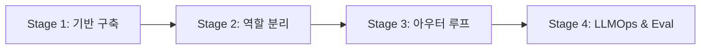

# 에필로그 (`ch11-epilogue`) — 에이전트 스택 도입 체크리스트 & 아키텍처 치트시트

## 1. 단원 학습 목표 & 12대 스택 4계층 위치

- **학습 목표 1**: 1계층(지식/기억) ~ 4계층(위임/검증) 전체 아키텍처 치트시트를 한눈에 점검한다.
- **학습 목표 2**: Stage 1(기반 구축) → Stage 2(역할 분리) → Stage 3(아우터 루프) → Stage 4(LLMOps) 4단계 도입 기준을 이해한다.
- **학습 목표 3**: `ch11-epilogue/` 폴더로 이동해 AI CLI에서 사용자 프롬프트로 `stage_readiness_check.py`와 전 단원 통합 검증(`verify_chapters.py --all`)을 완주한다.

| 도입 단계 | 핵심 기준 | 관련 단원 |
| :--- | :--- | :--- |
| **Stage 1. 기반 구축** | 상시 지침, 결정적 테스트, 검증 분리 | `ch01`~`ch04` |
| **Stage 2. 역할 분리** | 3-Agent 권한 분리, 파일 협업, 정량 채점 | `ch05`~`ch08` |
| **Stage 3. 루프 운영** | 아우터 루프 예산·비용 로거·중단 조건 | `ch09` |
| **Stage 4. 프로덕션** | Trace/Score, 3종 Eval, 라벨 롤백 | `ch10` |

## 2. 아키텍처 다이어그램 (Mermaid)



## 3. 디렉터리 및 소스 파일 구조

```text
ch11-epilogue/
├── README.md
├── AGENTS.md
├── CLAUDE.md
├── GEMINI.md
├── .claude/rules/readiness.md
├── .gemini/
├── stage_readiness_check.py
└── tests/
    └── test_stage_readiness.py
```

## 4. 실습 방식 & 사용자 입력 프롬프트 예시 (AI CLI)

### 4.1 실습 절차 (챕터 루트 이동 후 AI CLI 접속)

```bash
cd ch11-epilogue
claude   # 또는 agy / codex
```

### 4.2 사용자 입력 프롬프트 예시 (3개 이상)

- **프롬프트 예시 1 (Stage 1~4 도입 성숙도 JSON 진단)**:
  > "현재 `ch11-epilogue` 폴더에서 `python3 stage_readiness_check.py --format json`을 실행해 저장소의 Stage 1~4(`stage_1_foundation` ~ `stage_4_llmops`) 준비 상태와 `completed_stages: 4/4` 여부를 출력해줘."

- **프롬프트 예시 2 (누락 시나리오 시뮬레이션 및 단위 테스트 검증)**:
  > "`tests/test_stage_readiness.py`를 실행해 Stage 1~4 진단기의 단위 테스트 통과 여부를 확인하고, 각 Stage별로 어떤 핵심 파일을 검사하는지 표로 정리해줘."

- **프롬프트 예시 3 (전 단원 통합 게이트 `verify_chapters.py --all` 최종 검증)**:
  > "상위 저장소 통합 검증 스크립트(`python3 ../scripts/verify_chapters.py --all`)를 실행해 전 단원(`ch00`~`ch10`) 파일 구조, 지침서, 단위 테스트가 100% PASS하는지 최종 리포트를 출력해줘."

### 4.3 참고용 직접 실행 명령어

```bash
python3 stage_readiness_check.py --format json
python3 -m unittest discover -s tests -p "test_*.py" -v
python3 ../scripts/verify_chapters.py --all
```

## 5. 핵심 체크리스트

- [ ] `ch11-epilogue/` 루트에 `AGENTS.md`, `CLAUDE.md`, `GEMINI.md`, `.claude/`, `.gemini/`가 존재하는가?
- [ ] `stage_readiness_check.py --format json` 실행 시 본 저장소의 Stage 1~4가 모두 통과하는가?
- [ ] `python3 ../scripts/verify_chapters.py --all`이 전 단원 100% PASS를 출력하는가?
