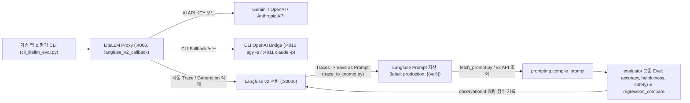

# 제11장 (`ch11-eval-and-llmops`) — 프로덕션의 눈과 저울: 평가(Eval)와 LLMOps

## 1. 단원 학습 목표 & 12대 스택 4계층 위치

- **학습 목표 1**: `Launch → Observe → Evaluate → Improve` 4단계 LLMOps 개선 루프를 구축한다.
- **학습 목표 2**: 기존 앱 코드 수정 없이 **LiteLLM 프록시(`OPENAI_BASE_URL`)만으로 Langfuse에 트레이스를 적재하는 무코드 관측(Zero-Code Observation)**을 구성한다.
- **학습 목표 3**: `ch11-eval-and-llmops/` 폴더로 이동해 AI CLI에서 사용자 프롬프트로 **Traces → Save as Prompt**(`trace_to_prompt.py`), 라벨 조회(`fetch_prompt.py`), 3종 Eval 회귀 비교(`regression_compare.py`)를 실행한다.

| 계층 (Layer) | 12대 스택 요소 | 본 단원의 핵심 구현 |
| :--- | :--- | :--- |
| **Layer 4. 위임과 검증** | ⑫ Eval & LLMOps | `litellm_proxy/`, `cli_litellm_eval.py`, `seed_langfuse_dashboard.py`, `trace_to_prompt.py`, `fetch_prompt.py`, `langfuse_ops.py`, `evaluator.py`, `regression_compare.py` |

## 2. 아키텍처 다이어그램 (Mermaid)



## 3. 디렉터리 및 소스 파일 구조

- 정식 구현 경로 (챕터 루트): `ch11-eval-and-llmops/`
- 도서 본문 `💻 Git 예제` 호환 경로: `ch11/support-assistant/` (`-> ../ch11-eval-and-llmops` 심볼릭 링크)

```text
ch11-eval-and-llmops/
├── README.md
├── AGENTS.md
├── CLAUDE.md
├── GEMINI.md
├── .claude/rules/eval-llmops.md
├── .gemini/
├── litellm_proxy/
│   ├── litellm_config.yaml · docker-compose.litellm.yml · .env.example
│   ├── langfuse_v2_callback.py · zero_code_proxy_demo.py
│   ├── cli_openai_bridge.py · gemini_openai_bridge.py · claude_openai_bridge.py
│   └── client_claude.py · client_chatgpt.py · client_gemini.py
├── models.py · prompting.py · sample_dataset.json
├── langfuse_ops.py · seed_prompts.py · seed_langfuse_dashboard.py
├── trace_to_prompt.py · fetch_prompt.py
├── evaluator.py · regression_compare.py
├── cli_litellm_eval.py · gemini_litellm_eval.py · claude_litellm_eval.py
└── tests/
    └── test_support_assistant.py
```

## 4. 실습 방식 & 사용자 입력 프롬프트 예시 (AI CLI)

### 4.1 실습 절차 (챕터 루트 이동 후 AI CLI 접속)

```bash
cd ch11-eval-and-llmops
claude   # 또는 agy / codex
```

### 4.2 사용자 입력 프롬프트 예시 (3개 이상)

- **프롬프트 예시 1 (Trace → Save as Prompt 승격 및 `production` 프롬프트 Fetch)**:
  > "현재 `ch11-eval-and-llmops` 폴더에서 `python3 trace_to_prompt.py --demo --json`과 `python3 fetch_prompt.py --demo --json`을 순서대로 실행해 Trace 입력 페이로드가 `{{var}}` 템플릿으로 승격되고 `production` 라벨로 컴파일되는 결과를 출력해줘."

- **프롬프트 예시 2 (3종 Eval 기반 `production` vs `candidate` 회귀 비교)**:
  > "`python3 regression_compare.py`를 실행해 `production`(v1)과 `candidate`(v2) 프롬프트의 3종 Eval(`accuracy`, `helpfulness`, `safety`) 평균 점수와 통과율(`pass_rate`)을 비교해줘."

- **프롬프트 예시 3 (무코드 LiteLLM 프록시 데모 및 Langfuse Mock 통합 테스트)**:
  > "`python3 litellm_proxy/zero_code_proxy_demo.py`로 무코드 프록시 관측을 확인하고, `python3 -m unittest discover -s tests -p 'test_*.py' -v`로 Langfuse v2 API Mock 테스트 통과 여부를 출력해줘."

### 4.3 시나리오별 실행 명령어 (컨테이너/로컬)

```bash
python3 litellm_proxy/zero_code_proxy_demo.py
python3 trace_to_prompt.py --demo --json
python3 fetch_prompt.py --demo --json
python3 regression_compare.py
python3 seed_langfuse_dashboard.py --json
python3 -m unittest discover -s tests -p "test_*.py" -v
```

## 5. 핵심 체크리스트

- [ ] `ch11-eval-and-llmops/` 루트에 `AGENTS.md`, `CLAUDE.md`, `GEMINI.md`, `.claude/`, `.gemini/`가 존재하는가?
- [ ] `trace_to_prompt.py`가 Trace 입력에서 `{{var}}` 변수를 추출해 `production` 라벨로 등록하는가?
- [ ] `regression_compare.py`가 `production` 대비 `candidate`의 점수 향상을 정량적으로 검증하는가?
