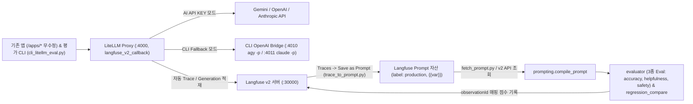

# 제11장. 프로덕션의 눈과 저울: 평가(Eval)와 LLMOps

## 1. 단원 학습 목표 & 12대 스택 4계층 위치

- **학습 목표 1**: `Launch → Observe → Evaluate → Improve` 4단계 LLMOps 개선 루프를 구축한다.
- **학습 목표 2**: `/apps/*` 기존 애플리케이션 코드 수정 없이 **LiteLLM 프록시(`OPENAI_BASE_URL`)만으로 Langfuse에 트레이스를 적재하는 무코드 관측(Zero-Code Observation)**을 구성한다.
- **학습 목표 3**: Langfuse 대시보드 **Traces → Save as Prompt** 및 `trace_to_prompt.py`로 기존 호출 입력(Input) 페이로드를 버전 관리되는 프롬프트 자산(`{{var}}`)으로 즉시 승격한다.
- **학습 목표 4**: `langfuse_ops.py`(`/api/public/v2/prompts`, `/api/public/ingestion`, `/api/public/models` HTTP 연동 + 오프라인 JSONL 폴백)와 `fetch_prompt.py`로 `production` 라벨 프롬프트를 앱에 동적 반영하고 3종 Eval·회귀 비교를 수행한다.
- **학습 목표 5**: 상황(**AI API KEY 보유** / **Fallback 모드** / **원클릭 Demo 모드**)에 따라 LiteLLM을 거쳐 Langfuse 대시보드(`Traces`, `Generations`, `Scores`, `Models`, `Datasets`)에서 실시간 모니터링 및 품질 평가를 수행한다.

| 계층 (Layer) | 12대 스택 요소 | 본 단원의 핵심 구현 |
| :--- | :--- | :--- |
| **Layer 4. 위임과 검증** | ⑫ Eval & LLMOps | `litellm_proxy/`(무코드 관측 & CLI 브리지), `cli_litellm_eval.py`, `seed_langfuse_dashboard.py`, `trace_to_prompt.py`(Save as Prompt), `fetch_prompt.py` & `langfuse_ops.py`, `evaluator.py`, `regression_compare.py` |

## 2. 아키텍처 다이어그램 (Mermaid)



## 3. 디렉터리 및 소스 파일 구조

- 정식 경로: `ch11-eval-and-llmops/support-assistant/`
- 도서 본문 `💻 Git 예제` 호환 경로: `ch11/support-assistant/` (`-> ../ch11-eval-and-llmops/support-assistant`)

| 파일 / 디렉터리 | 역할 |
| :--- | :--- |
| `litellm_proxy/litellm_config.yaml` | 멀티 플랫폼 모델 라우팅(`gemini-2.5-flash`, `gpt-4o-mini`, `claude-sonnet`, `gemini-cli`, `claude-cli`, `local-ollama`) 및 `langfuse_v2_callback` 연동 설정 |
| `litellm_proxy/langfuse_v2_callback.py` | Langfuse v2 배치 수집(`/api/public/ingestion`) 전용 커스텀 콜백 (`userId`, `sessionId`, `tags`, `promptName`, `promptVersion`, `observationId`, 실제 `latency`, `usage` 기록) |
| `litellm_proxy/cli_openai_bridge.py` | API Key 없이 로그인된 CLI(`agy -p`, `claude -p`)를 OpenAI 호환 HTTP API(`/v1/chat/completions`)로 노출하는 공통 브리지 코어 |
| `litellm_proxy/gemini_openai_bridge.py` | Gemini Antigravity CLI(`agy -p`) OpenAI 호환 브리지 서버 (기본 포트: `4010`) |
| `litellm_proxy/claude_openai_bridge.py` | Claude Code CLI(`claude -p`) OpenAI 호환 브리지 서버 (기본 포트: `4011`) |
| `litellm_proxy/docker-compose.litellm.yml` | LiteLLM Proxy 단독 컨테이너 기동 구성 (`4000:4000`) |
| `litellm_proxy/.env.example` | `OPENAI_BASE_URL=http://localhost:4000/v1` 및 Langfuse 키 예시 |
| `litellm_proxy/zero_code_proxy_demo.py` | 기존 앱 코드 수정 없이 `OPENAI_BASE_URL` 전환만으로 트레이스 수집 시연 |
| `litellm_proxy/client_*.py` | `client_claude.py`, `client_chatgpt.py`, `client_gemini.py` 플랫폼별 무코드 프록시 호출 클라이언트 |
| `models.py` | `SupportTicket`, `PromptRecord` (`{{var}}` Mustache + `{var}` 이중 컴파일), `EvalReport` |
| `langfuse_ops.py` | Langfuse Public API(`/api/public/v2/prompts`, `/api/public/traces`, `/api/public/ingestion`, `/api/public/models`) HTTP Basic Auth 실연동 + 오프라인 JSONL 폴백 |
| `cli_litellm_eval.py` | LiteLLM Proxy 경유 추론 + Langfuse Trace/Generation 적재 + 3종 Eval 점수(`accuracy`, `helpfulness`) 자동 매핑 공통 평가 엔진 |
| `gemini_litellm_eval.py` | `gemini-cli` 모델 그룹으로 LiteLLM ➔ Gemini CLI 브리지 ➔ Langfuse 평가를 수행하는 실행기 |
| `claude_litellm_eval.py` | `claude-cli` 모델 그룹으로 LiteLLM ➔ Claude CLI 브리지 ➔ Langfuse 평가를 수행하는 실행기 |
| `seed_langfuse_dashboard.py` | Langfuse v2 대시보드 전 영역(`Traces` 72건, `Scores` 144건, `Sessions` 24개, `Datasets`, `Models`) 시계열 일괄 초기화 시더 |
| `trace_to_prompt.py` | 기존 Trace 입력 페이로드에서 `{{var}}` 프롬프트 추출 및 `production` 라벨 승격 등록 CLI |
| `fetch_prompt.py` | Langfuse에서 확인한 `production` 프롬프트를 조회·컴파일해 앱에 적용하는 CLI |
| `seed_prompts.py` | `support-answer` v1(`production`) / v2(`candidate`) 시드 등록 |
| `prompting.py` | `compile_prompt(prompt, ticket: SupportTicket) -> str` |
| `evaluator.py` | 규칙 기반(`accuracy`)·완전성(`helpfulness`)·안전성(`safety`) 3종 Eval 평가기 |
| `regression_compare.py` | `production` vs `candidate` 버전 간 품질 점수·통과율 회귀 비교 및 Langfuse Trace/Score 기록기 |

### 3.1 무코드 관측 & Save as Prompt 실전 워크플로

1. **앱 코드 변경 없이 LiteLLM 프록시로 트레이스 적재**:
   - 실행 중인 앱 환경 변수만 `OPENAI_BASE_URL=http://localhost:4000/v1`(컨테이너 내부는 `http://litellm-proxy:4000/v1`)로 지정하면, `/apps/*`의 다른 프로젝트 소스를 한 줄도 고치지 않고 모든 LLM 요청/응답이 Langfuse `Traces` 및 `Generations`에 자동 기록됩니다.
2. **기존 트레이스(Trace) 데이터에서 프롬프트 추출 등록 ("Save as Prompt")**:
   - 대시보드 `Traces` 탭에서 실제 호출된 입력(Input) 페이로드를 선택하고 **"Save as Prompt"** 버튼을 클릭하면 별도 파일 작성 없이 즉시 프롬프트 자산(예: `support-answer`, `{{ticket_id}}`)으로 승격됩니다.
   - CLI 자동화가 필요할 때는 `python3 ch11-eval-and-llmops/support-assistant/trace_to_prompt.py --trace-id <ID> --name support-answer --label production`을 실행합니다.
3. **랭퓨즈에서 확인한 프롬프트를 코드로 가져오기**:
   - `LANGFUSE_HOST`, `LANGFUSE_PUBLIC_KEY`, `LANGFUSE_SECRET_KEY`를 설정한 뒤 `fetch_prompt.py`(또는 `LangfuseOpsClient.get_prompt(..., label="production")`)를 호출하면 서버의 최신 `production` 프롬프트를 가져와 `compile_prompt()`로 치환합니다.

## 4. 컨테이너 실행 & 테스트 명령어

> **전제 조건**: `dockers/` 환경에서 `docker compose up -d --build`로 4개 컨테이너(`db_postgres`, `langfuse`, `litellm-proxy`, `app`)가 기동되어 있고, LiteLLM(`http://localhost:4000/health/liveliness` ➔ `"I'm alive!"`)과 Langfuse(`http://localhost:30000`)가 정상 응답하는 상태여야 합니다.

### 4.1 시나리오별 핵심 실행 명령어 (단일 명령 요약표)

| 구분 (Scenario) | 추천 실행 명령어 (단일 명령) | 주요 역할 및 동작 설명 | LiteLLM ➔ Langfuse 관측 확인 항목 |
| :--- | :--- | :--- | :--- |
| **1. AI API KEY 모드**<br>*(실제 API 키 연동)* | `docker exec -e GEMINI_API_KEY="AIzaSy..." learn_loop_engineering_app python3 ch11-eval-and-llmops/support-assistant/cli_litellm_eval.py --model gemini-2.5-flash --json` | • 실제 API 키를 전달하여 LiteLLM을 통해 공식 LLM을 호출하고, 응답 품질 3종 자동 평가까지 원스톱 수행<br>• `gpt-4o-mini`, `claude-sonnet`으로 모델 교체 가능 | • **Traces**: 단일 트랜잭션 추적 (`userId`, `sessionId`, `tags`)<br>• **Generations**: 실제 모델 토큰/지연시간/비용 산출<br>• **Scores**: `accuracy`, `helpfulness` 점수 자동 매핑 |
| **2. Fallback 모드**<br>*(API 키 없을 때 / 오프라인)* | `docker exec learn_loop_engineering_app python3 ch11-eval-and-llmops/support-assistant/regression_compare.py` | • 외부 API 키나 네트워크 제한 환경에서 로컬 템플릿과 3중 규칙(키워드/완전성/안전성)으로 프롬프트(`production` vs `candidate`) 회귀 평가 실행<br>• 키 입력 없이 100% 자립 동작 | • **Traces**: 티켓별(`T-101-production` 등) 트레이스 생성<br>• **Scores**: 버전별 통과율 및 평균 점수 매핑<br>• **Prompts**: `support-answer` 버전별 라벨 연계 |
| **3. Demo 모드**<br>*(원클릭 대시보드 시연)* | `docker exec learn_loop_engineering_app python3 ch11-eval-and-llmops/support-assistant/seed_langfuse_dashboard.py --json` | • Langfuse의 모든 탭(`Traces`, `Generations`, `Scores`, `Models`, `Datasets`)을 즉시 채워주는 24시간 시계열 데이터셋 일괄 적재<br>• 발표 및 데모 시 즉시 시각화 화면 완성 | • **Traces**: 72건의 시계열 세션(24개) 데이터<br>• **Scores**: 144건의 다각도 평가 점수 (`# accuracy`, `# helpfulness`)<br>• **Models**: 커스텀 모델 가격표 및 누적 비용(`$0.106+`) |

### 4.2 경우별 상세 실행 가이드

#### 1) AI API KEY 모드 (Gemini / OpenAI / Anthropic)
LiteLLM Proxy(`:4000`)에 정의된 라우팅 모델을 호출하며, 사용하는 플랫폼의 API 키만 전달하면 즉시 동작합니다.

```bash
# Gemini API 사용 시
docker exec -e GEMINI_API_KEY="<YOUR_GEMINI_KEY>" learn_loop_engineering_app \
  python3 ch11-eval-and-llmops/support-assistant/cli_litellm_eval.py --model gemini-2.5-flash --json

# OpenAI API 사용 시
docker exec -e OPENAI_API_KEY="<YOUR_OPENAI_KEY>" learn_loop_engineering_app \
  python3 ch11-eval-and-llmops/support-assistant/cli_litellm_eval.py --model gpt-4o-mini --json

# Anthropic API 사용 시
docker exec -e ANTHROPIC_API_KEY="<YOUR_ANTHROPIC_KEY>" learn_loop_engineering_app \
  python3 ch11-eval-and-llmops/support-assistant/cli_litellm_eval.py --model claude-sonnet --json
```

#### 2) Fallback 모드 (로컬 오프라인 회귀 평가 및 CLI 브리지)
API 키가 없는 환경에서는 로컬 3중 휴리스틱 회귀 평가를 실행하거나, 컨테이너 내 로그인된 CLI 브리지(`gemini-cli` `:4010`, `claude-cli` `:4011`)를 통해 LiteLLM 관측 파이프라인을 그대로 검증할 수 있습니다.

```bash
# [권장] 외부 API 의존성 없이 프롬프트 버전(production vs candidate) 회귀 평가 및 Langfuse 기록
docker exec learn_loop_engineering_app \
  python3 ch11-eval-and-llmops/support-assistant/regression_compare.py

# Gemini CLI (`agy -p`) 브리지 경유 LiteLLM + Langfuse 평가 (CLI OAuth 로그인 완료 시)
docker exec learn_loop_engineering_app \
  python3 ch11-eval-and-llmops/support-assistant/gemini_litellm_eval.py --json

# Claude CLI (`claude -p`) 브리지 경유 LiteLLM + Langfuse 평가 (CLI 로그인 완료 시)
docker exec learn_loop_engineering_app \
  python3 ch11-eval-and-llmops/support-assistant/claude_litellm_eval.py --json
```

#### 3) Demo 모드 (Langfuse 웹 UI 전체 탭 즉시 시연)
```bash
# 기본 24시간 × 시간당 3건 = 72 Traces / 144 Scores / 5 Dataset Runs 일괄 시딩
docker exec learn_loop_engineering_app \
  python3 ch11-eval-and-llmops/support-assistant/seed_langfuse_dashboard.py --json
```
- 실행 후 브라우저에서 [http://localhost:30000](http://localhost:30000) (`admin@example.com` / `admin123456`) 접속 시 확인 항목:
  - **Traces**: 사용자별(`user_alice`, `user_bob`, `user_charlie`, `user_dana`) 세션, 지연시간(`Latency`), 토큰(`Usage`), 총비용(`Total Cost`), 태그(`Tags`)
  - **Generations**: 모델별 입출력 프롬프트, `Start Time`/`End Time`, `# helpfulness (api)`, `# accuracy (api)` 점수 컬럼
  - **Scores**: `observationId`와 연결된 `NUMERIC` 평가 점수 및 코멘트
  - **Models**: `gemini-cli`, `claude-cli`, `gpt-4o-mini`, `claude-3-5-sonnet`, `gemini-2.5-flash` 단가 정의

### 4.3 컨테이너 내부 기본 워크플로 및 단위 테스트

```bash
cd /apps/learn_Loop_engineering

# 1. 무코드 LiteLLM 프록시 관측 데모 (오프라인 Mock 프록시 실행)
python3 ch11-eval-and-llmops/support-assistant/litellm_proxy/zero_code_proxy_demo.py

# 2. Trace -> Save as Prompt 승격 및 조회 CLI 실행
python3 ch11-eval-and-llmops/support-assistant/trace_to_prompt.py --demo --json
python3 ch11-eval-and-llmops/support-assistant/fetch_prompt.py --demo --json

# 3. 버전 간 회귀 비교 및 단위 테스트 (Mock Langfuse v2 HTTP API 및 CLI 브리지 테스트 포함)
python3 ch11-eval-and-llmops/support-assistant/regression_compare.py
python3 -m unittest discover -s ch11-eval-and-llmops/support-assistant/tests -p "test_*.py" -v
```

## 5. 핵심 체크리스트

- [ ] `/apps/*` 타 프로젝트 코드 수정 없이 `OPENAI_BASE_URL` + LiteLLM 프록시 설정만으로 Langfuse 관측이 가능한가?
- [ ] **AI API KEY 모드**, **Fallback 모드**, **Demo 모드** 각각의 실행 명령어로 LiteLLM을 통한 Langfuse 모니터링(`Traces`, `Generations`, `Scores`, `Models`)이 정상 동작하는가?
- [ ] 기존 Trace의 입력 페이로드를 `Save as Prompt` 절차 또는 `trace_to_prompt.py`로 `{{var}}` 프롬프트로 승격할 수 있는가?
- [ ] `langfuse_ops.py`와 `fetch_prompt.py`가 실제 Langfuse Public API(`/api/public/v2/prompts`)와 오프라인 JSONL 폴백 모두에서 `production` 프롬프트를 가져와 치환하는가?
