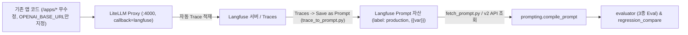

# 제11장. 프로덕션의 눈과 저울: 평가(Eval)와 LLMOps

## 1. 단원 학습 목표 & 12대 스택 4계층 위치

- **학습 목표 1**: `Launch → Observe → Evaluate → Improve` 4단계 LLMOps 개선 루프를 구축한다.
- **학습 목표 2**: `/apps/*` 기존 애플리케이션 코드 수정 없이 **LiteLLM 프록시(`OPENAI_BASE_URL`)만으로 Langfuse에 트레이스를 적재하는 무코드 관측(Zero-Code Observation)**을 구성한다.
- **학습 목표 3**: Langfuse 대시보드 **Traces → Save as Prompt** 및 `trace_to_prompt.py`로 기존 호출 입력(Input) 페이로드를 버전 관리되는 프롬프트 자산(`{{var}}`)으로 즉시 승격한다.
- **학습 목표 4**: `langfuse_ops.py`(`/api/public/v2/prompts` HTTP 연동 + 오프라인 JSONL 폴백)와 `fetch_prompt.py`로 `production` 라벨 프롬프트를 앱에 동적 반영하고 3종 Eval·회귀 비교를 수행한다.

| 계층 (Layer) | 12대 스택 요소 | 본 단원의 핵심 구현 |
| :--- | :--- | :--- |
| **Layer 4. 위임과 검증** | ⑫ Eval & LLMOps | `litellm_proxy/`(무코드 관측), `trace_to_prompt.py`(Save as Prompt), `fetch_prompt.py` & `langfuse_ops.py`, `evaluator.py`, `regression_compare.py` |

## 2. 아키텍처 다이어그램 (Mermaid)



## 3. 디렉터리 및 소스 파일 구조

- 정식 경로: `ch11-eval-and-llmops/support-assistant/`
- 도서 본문 `💻 Git 예제` 호환 경로: `ch11/support-assistant/` (`-> ../ch11-eval-and-llmops/support-assistant`)

| 파일 / 디렉터리 | 역할 |
| :--- | :--- |
| `litellm_proxy/litellm_config.yaml` | `success_callback: ["langfuse"]`, `failure_callback: ["langfuse"]` 프록시 설정 |
| `litellm_proxy/docker-compose.litellm.yml` | LiteLLM Proxy 컨테이너 기동 구성 (`4000:4000`) |
| `litellm_proxy/.env.example` | `OPENAI_BASE_URL=http://localhost:4000/v1` 및 Langfuse 키 예시 |
| `litellm_proxy/zero_code_proxy_demo.py` | 기존 앱 코드 수정 없이 `OPENAI_BASE_URL` 전환만으로 트레이스 수집 시연 |
| `models.py` | `SupportTicket`, `PromptRecord` (`{{var}}` Mustache + `{var}` 이중 컴파일), `EvalReport` |
| `langfuse_ops.py` | Langfuse Public API(`/api/public/v2/prompts`, `/api/public/traces`, `/api/public/ingestion`) HTTP Basic Auth 실연동 + 오프라인 JSONL 폴백 |
| `trace_to_prompt.py` | 기존 Trace 입력 페이로드에서 `{{var}}` 프롬프트 추출 및 `production` 라벨 승격 등록 CLI |
| `fetch_prompt.py` | Langfuse에서 확인한 `production` 프롬프트를 조회·컴파일해 앱에 적용하는 CLI |
| `seed_prompts.py` | `support-answer` v1(`production`) / v2(`candidate`) 시드 등록 |
| `prompting.py` | `compile_prompt(prompt, ticket: SupportTicket) -> str` |
| `evaluator.py` | 규칙 기반·정답/Judge·안전성 3종 Eval 평가기 |
| `regression_compare.py` | 버전 간 품질 점수·통과율 회귀 비교기 |

### 3.1 무코드 관측 & Save as Prompt 실전 워크플로

1. **앱 코드 변경 없이 LiteLLM 프록시로 트레이스 적재**:
   - 실행 중인 앱 환경 변수만 `OPENAI_BASE_URL=http://localhost:4000/v1`로 지정하면, `/apps/*`의 다른 프로젝트 소스를 한 줄도 고치지 않고 모든 LLM 요청/응답이 Langfuse `Traces`에 자동 기록됩니다.
2. **기존 트레이스(Trace) 데이터에서 프롬프트 추출 등록 ("Save as Prompt")**:
   - 대시보드 `Traces` 탭에서 실제 호출된 입력(Input) 페이로드를 선택하고 **"Save as Prompt"** 버튼을 클릭하면 별도 파일 작성 없이 즉시 프롬프트 자산(예: `support-answer`, `{{ticket_id}}`)으로 승격됩니다.
   - CLI 자동화가 필요할 때는 `python3 ch11-eval-and-llmops/support-assistant/trace_to_prompt.py --trace-id <ID> --name support-answer --label production`을 실행합니다.
3. **랭퓨즈에서 확인한 프롬프트를 코드로 가져오기**:
   - `LANGFUSE_HOST`, `LANGFUSE_PUBLIC_KEY`, `LANGFUSE_SECRET_KEY`를 설정한 뒤 `fetch_prompt.py`(또는 `LangfuseOpsClient.get_prompt(..., label="production")`)를 호출하면 서버의 최신 `production` 프롬프트를 가져와 `compile_prompt()`로 치환합니다.

## 4. 컨테이너 실행 & 테스트 명령어

```bash
cd /apps/learn_hermes_engineering

# 1. 무코드 LiteLLM 프록시 관측 데모 (오프라인 Mock 프록시 실행)
python3 ch11-eval-and-llmops/support-assistant/litellm_proxy/zero_code_proxy_demo.py

# 2. Trace -> Save as Prompt 승격 및 조회 CLI 실행
python3 ch11-eval-and-llmops/support-assistant/trace_to_prompt.py --demo --json
python3 ch11-eval-and-llmops/support-assistant/fetch_prompt.py --demo --json

# 3. 버전 간 회귀 비교 및 단위 테스트 (Mock Langfuse v2 HTTP API 포함)
python3 ch11-eval-and-llmops/support-assistant/regression_compare.py
python3 -m unittest discover -s ch11-eval-and-llmops/support-assistant/tests -p "test_*.py" -v
```

## 5. 핵심 체크리스트

- [ ] `/apps/*` 타 프로젝트 코드 수정 없이 `OPENAI_BASE_URL` + LiteLLM 프록시 설정만으로 Langfuse 관측이 가능한가?
- [ ] 기존 Trace의 입력 페이로드를 `Save as Prompt` 절차 또는 `trace_to_prompt.py`로 `{{var}}` 프롬프트로 승격할 수 있는가?
- [ ] `langfuse_ops.py`와 `fetch_prompt.py`가 실제 Langfuse Public API(`/api/public/v2/prompts`)와 오프라인 JSONL 폴백 모두에서 `production` 프롬프트를 가져와 치환하는가?
