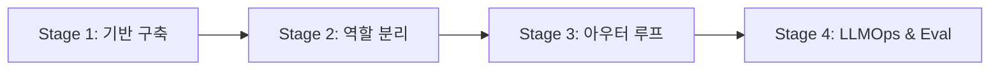

# 에필로그. 에이전트 스택 도입 체크리스트 & 아키텍처 치트시트

## 1. 단원 학습 목표 & 12대 스택 4계층 위치

- **학습 목표 1**: 1계층(지식/기억) ~ 4계층(위임/검증) 전체 아키텍처 치트시트를 한눈에 점검한다.
- **학습 목표 2**: Stage 1(기반 구축) → Stage 2(역할 분리) → Stage 3(아우터 루프) → Stage 4(LLMOps) 4단계 도입 기준을 이해한다.
- **학습 목표 3**: `stage_readiness_check.py`로 대상 저장소의 성숙도를 자동 진단한다.

| 도입 단계 | 핵심 기준 | 관련 단원 |
| :--- | :--- | :--- |
| **Stage 1. 기반 구축** | 상시 지침, 결정적 테스트, 검증 분리 | `ch01`~`ch05` |
| **Stage 2. 역할 분리** | 3-Agent 권한 분리, 파일 협업, 정량 채점 | `ch06`~`ch09` |
| **Stage 3. 루프 운영** | 아우터 루프 예산·비용 로거·중단 조건 | `ch10` |
| **Stage 4. 프로덕션** | Trace/Score, 3종 Eval, 라벨 롤백 | `ch11` |

## 2. 아키텍처 다이어그램 (Mermaid)



## 3. 디렉터리 및 소스 파일 구조

| 파일 | 역할 |
| :--- | :--- |
| `ch12-epilogue/stage_readiness_check.py` | 대상 저장소 Stage 1~4 성숙도 자동 진단 CLI (`--path`, `--format json|text`) |
| `ch12-epilogue/tests/test_stage_readiness.py` | Stage 1~4 진단 정확도 단위 테스트 |

## 4. 컨테이너 실행 & 테스트 명령어

```bash
cd /apps/learn_hermes_engineering
python3 ch12-epilogue/stage_readiness_check.py --format json
python3 -m unittest discover -s ch12-epilogue/tests -p "test_*.py" -v
python3 scripts/verify_chapters.py --all
```

## 5. 핵심 체크리스트

- [ ] `stage_readiness_check.py --format json` 실행 시 본 저장소의 Stage 1~4가 모두 통과하는가?
- [ ] `python3 scripts/verify_chapters.py --all`이 전 단원 100% PASS를 출력하는가?
