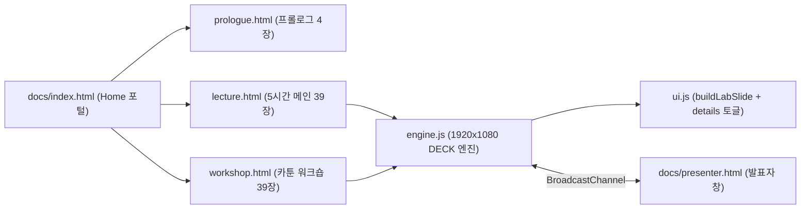

# 혼자서 프로젝트 5개 돌리는 개발자의 비밀: 루프 엔지니어링 (`docs/` Web PPT)

> **프롬프트 노가다는 끝났다 — 1인 멀티 프로젝트를 자동화하는 AI 설계·관측·개선 루프의 모든 것**
>
> 🔗 **웹 PPT 바로가기**: [https://yojulab.github.io/learn_Loop_engineering/](https://yojulab.github.io/learn_Loop_engineering/)

## 1. 단원 학습 목표

- 감으로 프롬프트만 고치는 패턴을 깨고 **배포(Launch) · 관측(Observe) · 평가(Evaluate) · 개선(Improve)** 의 데이터 기반 루프로 전환하는 **정적 웹 PPT 포털**을 제공한다.
- `index.html`(Home 분기 포털), `prologue.html`(전용 프롤로그 4장), `lecture.html`(5시간 메인 39장), `workshop.html`(카툰 심화 워크숍 39장)을 제공한다.
- `ch00`~`ch12` 전 단원의 **이론 + 실습 미션 + 클릭 토글(`<details>`) 모범 답안 & 해결 프롬프트**를 한 페이지에 배치한다.
- 기존 [`ARCHITECTURE.md`](ARCHITECTURE.md) 4계층 12대 스택 설계서를 보존하면서 GitHub Pages(`/docs`)에서 무빌드로 즉시 실행한다.

## 2. 아키텍처 다이어그램



## 3. 디렉터리 및 소스 파일 구조

| 파일 경로 | 역할 | 비고 |
| :--- | :--- | :--- |
| `docs/.nojekyll` | GitHub Pages Jekyll 처리 비활성화 | 정적 자산 그대로 서빙 |
| `docs/ARCHITECTURE.md` | 4계층 12대 스택 핵심 설계서 | 기존 문서 보존 |
| `docs/index.html` / `docs/presenter.html` | Home 포털 & 발표자 대시보드 | 100% 상대 경로 |
| `docs/prologue.html` / `docs/lecture.html` / `docs/workshop.html` | 프롤로그 · 5시간 강의 · 카툰 워크숍 덱 | 독립 분기 덱 |
| `docs/deck.css` | 디자인 토큰, 6대 테마, `.lab-grid` | `prefers-reduced-motion` 준수 |
| `docs/engine.js` / `docs/ui.js` | 슬라이드 렌더러, 키보드 단축키, `<details>` 실습 빌더 | Heading-in-summary 금지 |
| `docs/slides/` · `docs/slides_workshop/` | 39장 강의·워크숍 슬라이드 & `ch00`~`ch12` 실습·답안 | `node --check` 검증 완료 |

## 4. 컨테이너 실행 & 테스트 명령어

```bash
# 로컬 정적 서버 미리보기 (GitHub Pages 동일 동작)
python3 -m http.server 8080 --directory docs

# JS 문법, 접근성, 13개 단원 실습/모범답안 검증
python3 -m unittest discover -s tests -p "test_*.py" -v
python3 scripts/verify_chapters.py --chapter webppt
```

## 5. 핵심 체크리스트

- [x] `index.html`, `prologue.html`, `lecture.html`, `workshop.html`의 모든 CSS/JS 경로가 `/`로 시작하지 않는 상대 경로인가?
- [x] `ch00`~`ch12` 13개 단원 모두 실습과 클릭 토글(`<details>`) 모범 답안이 한 슬라이드에 구성되어 있는가?
- [x] 기존 `docs/ARCHITECTURE.md`가 훼손 없이 보존되어 있는가?
