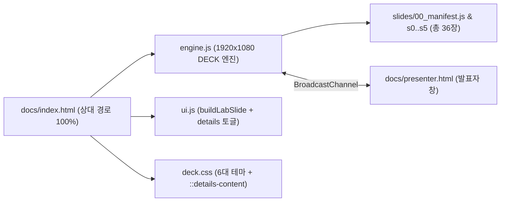

# `docs/` — GitHub Pages 5시간 과정 웹 PPT & 아키텍처 허브

## 1. 단원 학습 목표

- `revfactory.github.io/oss-lecture` 스타일(`1920×1080` 고정 비율 `.stage` 스케일링, 6대 테마 토큰, Git-branch 하단 레일, `BroadcastChannel` 발표자 창, `?print` PDF 인쇄)을 기반으로 **5시간(300분) 강의용 정적 웹 PPT**를 제공한다.
- `ch00`~`ch12` 전 단원의 **이론 + 실습 미션 + 클릭 토글(`<details>`) 모범 답안(Tree · 코드 · CLI 출력)** 을 한 페이지에 배치한다.
- 기존 [`ARCHITECTURE.md`](ARCHITECTURE.md) 4계층 12대 스택 설계서를 그대로 보존하면서 GitHub Pages(`/docs`)에서 무빌드로 즉시 실행한다.

## 2. 아키텍처 다이어그램



## 3. 디렉터리 및 소스 파일 구조

| 파일 경로 | 역할 | 비고 |
| :--- | :--- | :--- |
| `docs/.nojekyll` | GitHub Pages Jekyll 처리 비활성화 | 정적 자산 그대로 서빙 |
| `docs/ARCHITECTURE.md` | 4계층 12대 스택 핵심 설계서 | 기존 문서 보존 |
| `docs/index.html` / `docs/presenter.html` | 메인 덱 진입점 & 발표자 대시보드 | 100% 상대 경로 |
| `docs/deck.css` | 디자인 토큰, 6대 테마, `.lab-grid`, `?print` 인쇄 규칙 | `prefers-reduced-motion` 준수 |
| `docs/engine.js` / `docs/ui.js` | 슬라이드 렌더러, 키보드 단축키, `<details>` 실습 빌더 | Heading-in-summary 금지 |
| `docs/slides/00_manifest.js`, `s0..s5` | Intro + Part 1~4B 36장 슬라이드 & `ch00`~`ch12` 실습·답안 | `node --check` 검증 완료 |

## 4. 컨테이너 실행 & 테스트 명령어

```bash
# 로컬 정적 서버 미리보기 (GitHub Pages 동일 동작)
python3 -m http.server 8080 --directory docs

# JS 문법, 접근성, 13개 단원 실습/모범답안 검증
python3 -m unittest discover -s tests -p "test_*.py" -v
python3 scripts/verify_chapters.py --chapter webppt
```

## 5. 핵심 체크리스트

- [x] `index.html`의 모든 CSS/JS 경로가 `/`로 시작하지 않는 상대 경로인가?
- [x] `ch00`~`ch12` 13개 단원 모두 실습과 클릭 토글(`<details>`) 모범 답안이 한 슬라이드에 구성되어 있는가?
- [x] 기존 `docs/ARCHITECTURE.md`가 훼손 없이 보존되어 있는가?
