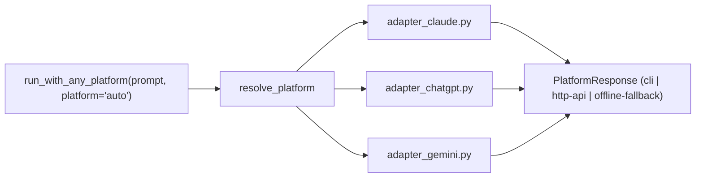

# Any-Platform 어댑터 계층 (Claude · ChatGPT · Gemini)

## 1. 단원 학습 목표 & 12대 스택 4계층 위치

- **학습 목표 1**: Claude, ChatGPT(OpenAI/Codex), Gemini(Antigravity) 어느 플랫폼에서도 동일하게 동작하는 공용 실행 계층을 제공한다.
- **학습 목표 2**: `resolve_platform("auto")`로 API 키/CLI를 자동 탐지하고, 오류/오프라인 시 `offline-fallback`으로 무중단 동작을 보장한다.

## 2. 아키텍처 다이어그램 (Mermaid)



## 3. 디렉터리 및 소스 파일 구조

- `base.py`: `resolve_platform`, `get_adapter`, `run_with_any_platform`, `OfflineFallbackAdapter`
- `adapter_claude.py`: Claude Code CLI & Anthropic Messages API 어댑터
- `adapter_chatgpt.py`: Codex CLI & OpenAI Chat Completions (LiteLLM 호환) 어댑터
- `adapter_gemini.py`: Gemini CLI & Google Generative Language API 어댑터

## 4. 컨테이너 실행 & 테스트 명령어

```bash
python3 -m unittest discover -s platforms/tests -p "test_*.py" -v
```

## 5. 핵심 체크리스트

- [ ] API 키 미설정/인증 오류 시에도 `offline-fallback`으로 예외 없이 응답하는가?
- [ ] Mock HTTP 서버 기반 3대 플랫폼 API 호출 단위 테스트가 모두 통과하는가?
